# Ứng dụng mạng Lightweight GNN gợi ý phát hiện xâm nhập IoT thời gian thực

**Báo cáo cuối kỳ**

Nhóm thực hiện: Nguyễn Minh Phúc (nhóm trưởng), Lê Trung Phong, Văn Bá Phạm Tấn
Mã nguồn: `minucedev/gnn-iot-ids` · Phiên bản báo cáo: bản 1 (16/11/2026), hạn nộp tạm tính 19/11/2026

> **Trạng thái bản này.** Giai đoạn A–H (dữ liệu, EDA, baseline, GNN, hybrid, ablation, đóng băng và chạy test một lần) đã xong; mọi số liệu của chương 3–5 lấy từ file trong `reports/` và `docs/`, mỗi bảng ghi nguồn bên dưới. Phần **AHP** và **mô phỏng thời gian thực** thuộc giai đoạn I đang chạy ở phiên khác, nên các mục đó chỉ có tiêu đề và dấu **[chờ GĐ I]**. Tài liệu tham khảo có mục chưa kiểm chứng đủ được đánh dấu **[cần kiểm tra]** (xem mục "Tài liệu tham khảo").

## Mục lục

- [Tóm tắt](#tóm-tắt)
- [Danh mục từ viết tắt và ký hiệu](#danh-mục-từ-viết-tắt-và-ký-hiệu)
- [Chương 1. Tổng quan](#chương-1-tổng-quan)
- [Chương 2. Cơ sở lý thuyết](#chương-2-cơ-sở-lý-thuyết)
- [Chương 3. Dữ liệu và phân tích khám phá (EDA)](#chương-3-dữ-liệu-và-phân-tích-khám-phá-eda)
- [Chương 4. Phương pháp và thực nghiệm](#chương-4-phương-pháp-và-thực-nghiệm)
- [Chương 5. Kết quả](#chương-5-kết-quả)
- [Chương 6. Kết luận](#chương-6-kết-luận)
- [Phụ lục A. Đối chiếu 5 yêu cầu của thầy ngày 12/11/2026](#phụ-lục-a-đối-chiếu-5-yêu-cầu-của-thầy-ngày-12112026)
- [Phụ lục B. Nguồn số liệu và cách truy vết](#phụ-lục-b-nguồn-số-liệu-và-cách-truy-vết)
- [Phụ lục C. Các notebook Kaggle và giờ GPU](#phụ-lục-c-các-notebook-kaggle-và-giờ-gpu)
- [Tài liệu tham khảo](#tài-liệu-tham-khảo)

**Quy ước trình bày.** Số thập phân dùng dấu phẩy. "± " là độ lệch chuẩn của 3 seed (42, 43, 44; ddof = 1 theo `summary_*.csv`). Hình và bảng đánh số theo chương (Hình 3.2, Bảng 5.1); đường dẫn hình là đường dẫn tương đối từ thư mục `report/`.

---

## Tóm tắt

Đề tài xây dựng bộ phát hiện xâm nhập cho mạng IoT dựa trên luồng NetFlow: mỗi cửa sổ 5 giây của luồng được dựng thành một đồ thị có hướng (node = địa chỉ IP, cạnh = các flow giữa hai IP), và mô hình phân loại từng node thành 5 nhóm (Normal, DoS_DDoS, Botnet_Backdoor, Truy_cap_trai_phep, Khac). Theo yêu cầu của thầy ngày 12/11/2026, nhóm dùng hai bộ dữ liệu NF-ToN-IoT-v3 (bộ chính) và NF-BoT-IoT-v3, chọn mô hình **hybrid GAT + LightGBM** làm mô hình chính, huấn luyện toàn bộ trên Kaggle (Tesla T4) và so sánh với baseline học máy (LR, RF, XGBoost, LightGBM), học sâu (MLP) và GNN đơn (GCN, GraphSAGE, GAT) trong cùng cách chia tập, 3 seed, kèm kiểm định McNemar. Tập test chỉ chạy một lần, sau khi đóng băng mô hình bằng tag `freeze-v1`.

Kết quả chính, trình bày đúng như số liệu cho phép:

1. Trên bộ chính NF-ToN-IoT-v3, **ở chế độ ngưỡng đã hiệu chỉnh**, hybrid chính có F1-macro test cao nhất (0,9677 ± 0,0005) và vượt có ý nghĩa so với baseline ML tốt nhất, MLP và phương án (c) (LightGBM + trung bình đặc trưng hàng xóm tính tay). So với GraphSAGE, hybrid chỉ nhỉnh hơn (+0,0078), **chưa đủ tiêu chí hơn 2 lần std** (0,0083). Ở chế độ argmax, (c) nhỉnh hơn hybrid 0,0005 (ngang nhau), nên hybrid không phải mô hình cao nhất ở chế độ này.
2. Trên NF-BoT-IoT-v3, **LightGBM tốt hơn hybrid ở argmax** (F1-macro 0,9291 so với 0,9164; McNemar nghiêng về LightGBM ở cả 3 seed).
3. Phần lớn lợi thế của hybrid so với baseline đến từ **thông tin hàng xóm** chứ không phải từ embedding GAT: phương án (c) ngang hybrid trên val (ToN 0,9342 so với 0,9326; BoT 0,9335 so với 0,9357) và trên test.
4. Chỉ tiêu "hybrid vượt mọi baseline" **không đạt**.
5. **Hybrid nhẹ** (30.934 tham số, 986 KB) đạt mọi chỉ tiêu hiệu năng và độ nhẹ trên NF-ToN-IoT-v3 ở chế độ ngưỡng (accuracy 97,11%, FPR 2,27%, recall 95,65%, F1-macro 0,9588); ở argmax FPR 5,69% không đạt. Hybrid chính (144.518 tham số, 9,75 MB) không đạt ngưỡng tham số và kích thước.
6. FPR khoảng 18% trên NF-BoT-IoT-v3 là do **dữ liệu** (các IP máy tấn công cũng sinh flow Normal có đặc trưng giống lúc tấn công), không do mô hình hay cách gán nhãn; thử chéo giữa hai bộ rất kém (F1-macro 0,15–0,38).

Mô hình hybrid được thiết kế ban đầu (out-of-fold theo 5 nhóm khối liên tiếp) **thất bại** (F1-macro val 0,647 trên ToN, 0,714 trên BoT); nguyên nhân đã xác định và bản sửa (out-of-fold xen kẽ) được trình bày ở mục 4.4. Tổng giờ GPU Kaggle ghi nhận được là khoảng 4,09 giờ.

## Danh mục từ viết tắt và ký hiệu

| Viết tắt | Nghĩa |
|---|---|
| IDS | Intrusion Detection System, hệ thống phát hiện xâm nhập |
| GNN | Graph Neural Network, mạng nơ-ron đồ thị |
| GCN, GAT, GATv2 | Graph Convolutional Network, Graph Attention Network và phiên bản v2 |
| FPR | False Positive Rate = FP / (FP + TN), Normal là lớp âm |
| F1-macro | Trung bình F1 của từng lớp; chỉ tiêu tính trên 4 lớp chính (D5), bộ BoT tính trên 3 lớp có mặt |
| OOF | Out-of-fold, embedding của tập train sinh từ mô hình không thấy node đó |
| (c) | Phương án ablation "LightGBM + trung bình 18 đặc trưng của các node kề", tính tay, không học |
| argmax, ngưỡng | Hai chế độ dự đoán: lớp có xác suất cao nhất; hoặc ngưỡng 1 − P(Normal) hiệu chỉnh trên val để FPR val ≤ 4,08% |
| GĐ | Giai đoạn của kế hoạch (A–J) |

---

## Chương 1. Tổng quan

### 1.1 Bài toán

Gateway của mạng IoT thu được luồng NetFlow liên tục. Đề tài cần một mô hình đủ nhẹ để chạy trên gateway, phát hiện địa chỉ IP đang tấn công (DDoS, botnet, truy cập trái phép) trong vòng dưới 1 giây và gợi ý mô hình nên triển khai (bằng AHP).

**Dữ liệu vào.** Dãy flow $F = \{f_1, f_2, \dots\}$, mỗi flow $f = (t, \text{src\_ip}, \text{dst\_ip}, \text{proto}, \text{ports}, \text{bytes}, \text{pkts}, \text{duration}, \text{flags})$.

**Dựng đồ thị.** Trục thời gian được chia thành các cửa sổ dài $W = 5$ giây, bước $S = W$. Cửa sổ $k$ cho đồ thị có hướng $G_k = (V_k, E_k)$: $V_k$ là các IP xuất hiện trong cửa sổ, mỗi node có vector 18 đặc trưng; cạnh $u \to v$ tồn tại nếu có ít nhất một flow từ $u$ đến $v$ và mang 3 đặc trưng (số flow, byte, gói). Nhãn node là nhãn chiếm đa số trong các flow do node khởi tạo (node chỉ nhận flow thì lấy đa số các flow nhận).

**Nhiệm vụ.** Học hàm $f_\theta(G_k) \to \hat{y}_v$ cho mọi $v \in V_k$. Bài toán chính là đa lớp 5 nhóm; từ dự đoán đa lớp suy ra bài toán nhị phân (Normal so với tấn công) để tính FPR và recall tấn công.

**Định nghĩa dùng xuyên suốt.**

- *Node có khởi tạo flow* (initiator) là node gửi ít nhất một flow trong cửa sổ; *node chỉ nhận* (receive-only) là node chỉ nhận flow (thường là nạn nhân hoặc máy chủ).
- *Độ trễ* là thời gian từ lúc đóng cửa sổ đến lúc có dự đoán, đo trên CPU 1 luồng.
- *Hai chế độ dự đoán* "argmax" và "ngưỡng" như ở bảng viết tắt; cả hai đều được báo cáo.

### 1.2 Mục tiêu

1. Xây dựng và đánh giá mô hình hybrid GAT + LightGBM trên hai bộ NetFlow (NF-ToN-IoT-v3, NF-BoT-IoT-v3).
2. Chứng minh (hoặc bác bỏ) bằng thực nghiệm có kiểm định rằng hybrid vượt các baseline ML, DL và GNN đơn.
3. Làm bản hybrid nhẹ (≤ 100.000 tham số, ≤ 1 MB) và đo đánh đổi giữa độ chính xác và độ nhẹ.
4. Dùng AHP để gợi ý mô hình triển khai và mô phỏng phát lại flow theo thời gian thực **[chờ GĐ I]**.

### 1.3 Yêu cầu của thầy ngày 12/11/2026

Thầy yêu cầu: (1) dùng NF-ToN và ít nhất 2 bộ dữ liệu; (2) cho biết có dùng mô hình hybrid không và lý do chọn; (3) chạy trên Kaggle với 30 giờ và GPU T4; (4) có xử lý EDA; (5) có minh chứng hybrid cao hơn các baseline (ML, DL, …). Bảng đối chiếu từng yêu cầu với mục trong báo cáo nằm ở [Phụ lục A](#phụ-lục-a-đối-chiếu-5-yêu-cầu-của-thầy-ngày-12112026).

### 1.4 Chỉ tiêu nghiệm thu

Chỉ tiêu đo trên tập test của bộ chính, trung bình 3 seed. Hai ngưỡng 91% và 4,08% lấy từ mô tả đề tài; các ngưỡng còn lại do nhóm trưởng chốt ngày 03/11/2026.

**Bảng 1.1. Chỉ tiêu nghiệm thu.**

| Chỉ tiêu | Ngưỡng | Cách đo |
|---|---|---|
| Accuracy đa lớp (mức node) | ≥ 91% | Tập test, chạy một lần |
| FPR nhị phân | ≤ 4,08% | FP / (FP + TN), Normal là lớp âm |
| Recall tấn công | ≥ 95% | TP / (TP + FN) |
| F1-macro (lớp chính) | ≥ 0,80 | Không tính lớp Khac (D5) |
| Độ ổn định | std accuracy ≤ 1,5 điểm % | 3 seed |
| Tổng tham số | ≤ 100.000 | Với hybrid: tham số các GAT + số lá LightGBM |
| Kích thước file mô hình | ≤ 1 MB | File mô hình đã lưu |
| Độ trễ | p95 ≤ 1 s mỗi cửa sổ | CPU 1 luồng; nhóm mới đo sơ bộ (mục 5.9) |
| So với baseline | Hybrid > baseline tốt nhất (ML, MLP, GNN đơn) về F1-macro, chênh > 2 lần std, kèm McNemar p < 0,05 | Không đạt thì báo cáo trung thực kèm phân tích |
| Số bộ dữ liệu | ≥ 2 | Yêu cầu của thầy ngày 12/11/2026 |
| Tái lập | Chạy lại lệch ≤ 0,5 điểm % | Notebook `21_reproduce` (chưa chạy) |

*Nguồn: `docs/gnn_ids/KE_HOACH.md` mục 3.*

### 1.5 Phạm vi

Trong phạm vi: phân loại ở mức node, hai bộ dữ liệu, mô phỏng phát lại flow. Ngoài phạm vi: giao diện web, triển khai trên mạng thật, phân loại ở mức flow (quyết định D4, đã bỏ vì hạn nộp). Mọi xử lý dữ liệu, huấn luyện và tổng hợp số liệu chạy trên Kaggle (D12); máy cá nhân chỉ sửa mã và tài liệu.

### 1.6 Cấu trúc báo cáo

Chương 2 trình bày cơ sở lý thuyết và lý do chọn hybrid; chương 3 mô tả dữ liệu, EDA, dựng đồ thị và cách chia tập; chương 4 mô tả mô hình và thực nghiệm, gồm cả thiết kế hybrid ban đầu đã thất bại; chương 5 trình bày kết quả; chương 6 kết luận, chỉ rõ chỉ tiêu đạt và chưa đạt, hạn chế và hướng phát triển.

---

## Chương 2. Cơ sở lý thuyết

### 2.1 IDS cho mạng IoT

IDS dựa trên chữ ký so khớp lưu lượng với mẫu tấn công đã biết; IDS dựa trên bất thường học mô hình hành vi bình thường hoặc học trực tiếp ranh giới giữa bình thường và tấn công. Học máy được dùng rộng rãi cho IDS nhưng gặp khó khăn riêng khi triển khai thực tế so với các bài toán học máy khác [1]. Với IDS, FPR đặc biệt quan trọng: lưu lượng bình thường chiếm áp đảo, nên một tỉ lệ cảnh báo giả nhỏ vẫn tạo ra lượng cảnh báo giả lớn, làm giảm giá trị của hệ thống (hiện tượng "base-rate fallacy") [2]. Vì vậy đề tài dùng đồng thời F1-macro (chống lệch lớp) và FPR cùng recall tấn công.

Mạng IoT có các đặc thù: thiết bị hạn chế tài nguyên, lưu lượng của thiết bị thường lặp và có chu kỳ, và gateway là điểm tập trung lưu lượng, phù hợp để đặt bộ phát hiện nhẹ. Ba nhóm tấn công chính của đề tài và hành vi mạng tương ứng:

| Nhóm nhãn | Hành vi mạng | Dấu hiệu kỳ vọng ở mức node |
|---|---|---|
| DoS_DDoS | Nhiều flow ngắn tới cùng đích để làm cạn tài nguyên; DDoS đến từ nhiều nguồn | Nạn nhân có bậc vào lớn (fan-in); nguồn có `n_out` lớn |
| Botnet_Backdoor | Thiết bị bị chiếm quyền kết nối ra điều khiển, hoặc cửa hậu nhận lệnh từ ngoài | Kết nối lặp tới ít đích; khó thấy ở mức node (xem mục 5.7) |
| Truy_cap_trai_phep | Dò quét (scanning), dò mật khẩu, tiêm mã, XSS, trộm dữ liệu | Nguồn quét có nhiều đích hoặc cổng khác nhau (`uniq_dst`, `uniq_dport`), tỉ lệ flow không phản hồi cao |

Hai khảo sát về GNN cho IDS [3, 4] tổng hợp các hướng làm; E-GraphSAGE [21] phân loại flow bằng cách học trên cạnh của đồ thị NetFlow và Anomal-E [22] dùng học tự giám sát trên cùng kiểu đồ thị. Đề tài khác các công trình này ở mức phân loại (node, không phải flow), nên **không so trực tiếp** số liệu (task 6.4 chưa làm; báo cáo không đưa ra khẳng định "tốt hơn nghiên cứu khác").

### 2.2 NetFlow

NetFlow là **định dạng** xuất thông tin luồng (flow): một flow là chuỗi gói tin cùng bộ năm (IP nguồn, IP đích, cổng nguồn, cổng đích, giao thức) được tổng hợp thành một bản ghi gồm số gói, số byte, thời gian, cờ TCP… Định dạng này được chuẩn hóa trong NetFlow v9 [5] và IPFIX [6]. Các bộ dữ liệu có tên NF-* (NF-ToN-IoT, NF-BoT-IoT, NF-UNSW-NB15, NF-CSE-CIC-IDS2018) **không phải là bộ dữ liệu gốc**: chúng là bản chuyển đổi của các bộ dữ liệu gói tin gốc (ToN-IoT, BoT-IoT, UNSW-NB15, CSE-CIC-IDS2018) sang định dạng NetFlow với bộ đặc trưng thống nhất [7]. Bản v3 bổ sung các đặc trưng thời gian (thời điểm bắt đầu và kết thúc flow, thời gian giữa các gói) [8, 9]; đây là điểm quyết định để dựng cửa sổ theo thời gian thật (mục 3.2).

### 2.3 Mạng nơ-ron đồ thị

**Truyền thông điệp.** GNN cập nhật biểu diễn của node $v$ bằng cách gom thông tin từ hàng xóm $\mathcal{N}(v)$ rồi biến đổi [13]:
$$h_v^{(l+1)} = \phi\Big(h_v^{(l)},\ \mathrm{AGG}\big(\{\psi(h_u^{(l)}, e_{uv}) : u \in \mathcal{N}(v)\}\big)\Big)$$
Các biến thể khác nhau ở hàm gom AGG. Tổng quan về GNN có ở [23, 24].

**GCN** [14] gom có chuẩn hóa theo bậc: $H^{(l+1)} = \sigma(\tilde D^{-1/2}\tilde A \tilde D^{-1/2} H^{(l)} W^{(l)})$, với $\tilde A = A + I$. Trọng số gom cố định theo cấu trúc, mọi hàng xóm đóng góp theo bậc.

**GraphSAGE** [15] gom (trung bình, max-pooling…) hàng xóm rồi ghép với biểu diễn của chính node: $h_v' = \sigma(W \cdot [h_v \,\|\, \mathrm{AGG}(\{h_u\})])$. Mô hình học tổng quát cho node chưa thấy (inductive).

**GAT** [16] học trọng số attention cho từng cặp $(i, j)$:
$$e_{ij} = \mathrm{LeakyReLU}\big(a^\top [W h_i \,\|\, W h_j]\big),\quad \alpha_{ij} = \frac{\exp(e_{ij})}{\sum_{k \in \mathcal{N}(i)} \exp(e_{ik})},\quad h_i' = \sigma\Big(\sum_{j \in \mathcal{N}(i)} \alpha_{ij} W h_j\Big)$$
trong đó $W$ là ma trận chiếu, $a$ là vector attention, $\|$ là phép ghép. **Multi-head attention** chạy $K$ bộ $(W^k, a^k)$ độc lập và ghép đầu ra: $h_i' = \Vert_{k=1}^{K} \sigma(\sum_j \alpha_{ij}^k W^k h_j)$; mỗi head có thể chú ý vào một kiểu quan hệ khác nhau và việc trung bình qua nhiều head làm ổn định học.

**GATv2** [17] sửa điểm yếu "attention tĩnh" của GAT bằng cách đổi thứ tự phép phi tuyến: $e_{ij} = a^\top \mathrm{LeakyReLU}(W [h_i \,\|\, h_j])$, và cho phép thêm đặc trưng cạnh $e_{ij}$ vào bên trong. Đề tài dùng GATv2 (`GATv2Conv` của PyTorch Geometric) với đặc trưng cạnh 3 chiều, nên khi báo cáo viết "GAT" là GATv2 này.

**Đồng chất (homophily).** Edge homophily là tỉ lệ cạnh nối hai node cùng nhãn [18]; class-insensitive homophily hiệu chỉnh theo kích thước lớp [19]; adjusted homophily trừ đi mức kỳ vọng khi ghép ngẫu nhiên [20]. Homophily cao nghĩa là gom thông tin hàng xóm thường mang nhãn cùng lớp và giúp GNN làm mượt dự đoán; homophily thấp thì hàng xóm có thể gây nhiễu.

### 2.4 Mô hình cây, MLP và lý do cây mạnh trên dữ liệu dạng bảng

Các baseline gồm hồi quy logistic (LR), rừng ngẫu nhiên (RF) [25], XGBoost [26], LightGBM [27] và mạng MLP. LightGBM xây cây tăng cường gradient theo hướng tăng trưởng từng lá (leaf-wise) với tối ưu hóa dựa trên histogram, cho tốc độ cao và xác suất đầu ra dễ hiệu chỉnh ngưỡng. Nhiều nghiên cứu cho thấy trên dữ liệu dạng bảng cỡ vừa, mô hình cây vẫn thường ngang hoặc hơn mô hình học sâu [28, 29]; vì vậy LightGBM là ứng viên tự nhiên cho vai trò bộ phân loại cuối trên 18 đặc trưng cấp node.

### 2.5 Mô hình hybrid GAT + LightGBM và lý do chọn

**Kiến trúc.** (1) Huấn luyện GAT nhẹ để phân loại node; (2) cố định GAT, lấy vector ẩn sau lớp GAT cuối (64 chiều) làm embedding mang thông tin hàng xóm; (3) ghép embedding với 18 đặc trưng gốc đã chuẩn hóa thành 82 cột; (4) LightGBM phân loại 82 cột đó. Đây là dạng xếp chồng (stacking) [31] giữa mô hình đồ thị và mô hình cây, cùng tinh thần với các công trình kết hợp tăng cường gradient và GNN trên đồ thị có đặc trưng bảng [30].

**Lý do chọn** (giả thuyết lúc thiết kế, quyết định D9 ngày 12/11/2026):

1. Mô hình cây mạnh trên đặc trưng dạng bảng [28, 29] nhưng không nhìn thấy cấu trúc mạng quanh mỗi node.
2. GNN nắm được cấu trúc (ai liên lạc với ai) nhưng các số liệu sơ bộ ban đầu cho thấy FPR của GNN cao; embedding GAT mang thông tin cấu trúc mà 18 đặc trưng thiếu.
3. LightGBM cho xác suất dễ hiệu chỉnh ngưỡng quyết định, phù hợp để kéo FPR về mức 4,08%.
4. Phương án thay thế (GAT + GRU) cần viết nhiều mã mới trong thời gian ngắn (D9).

**Lưu ý trung thực.** Các số sơ bộ nói ở lý do 2 đến từ cách chia tập cũ (`reports/tables/prelim_split_v1/`) đã bị loại khỏi báo cáo (kế hoạch mục 5c), nên không dùng làm bằng chứng. Mục 5.3 và 5.4 đối chiếu giả thuyết này với số liệu cuối cùng: thông tin hàng xóm **có ích**, nhưng embedding GAT **không hơn** đặc trưng hàng xóm tính tay.

**Out-of-fold.** GAT đã nhìn thấy nhãn của node train, nên embedding train tính trực tiếp "quá sạch" và LightGBM có thể học vẹt. Giải pháp chuẩn của stacking [31] là dùng dự đoán out-of-fold; thiết kế cụ thể và lý do bản đầu thất bại ở mục 4.4.

### 2.6 Các chỉ số đánh giá và kiểm định McNemar

Với ma trận nhầm lẫn nhị phân (TP, FP, TN, FN; Normal là lớp âm):

| Chỉ số | Công thức | Lý do cần cho IDS |
|---|---|---|
| Accuracy | $(TP+TN)/N$ | Dễ bị chi phối bởi lớp Normal chiếm đa số |
| Recall tấn công | $TP/(TP+FN)$ | Tỉ lệ tấn công bị bắt; FN là tấn công lọt lưới |
| FPR | $FP/(FP+TN)$ | Tỉ lệ cảnh báo giả; quyết định gánh nặng vận hành [2] |
| Precision, F1 | $P = TP/(TP+FP)$, $F_1 = 2PR/(P+R)$ | Cân bằng giữa bắt được và báo nhầm |
| F1-macro | Trung bình $F_1$ từng lớp | Không để lớp lớn lấn át lớp nhỏ; tính trên 4 lớp chính (D5) |
| ROC-AUC | Diện tích dưới đường ROC của điểm $1-P(\text{Normal})$ | Chất lượng xếp hạng, không phụ thuộc ngưỡng [37]; xem thêm PR [38] |

**McNemar** so hai mô hình trên cùng tập node: gọi $b$ là số node mô hình A đúng, B sai; $c$ là số node A sai, B đúng [35]. Thống kê $\chi^2 = (|b-c|-1)^2/(b+c)$ (hiệu chỉnh liên tục) xấp xỉ $\chi^2_1$ khi $b+c$ đủ lớn; khi $b+c < 25$ dùng kiểm định nhị thức chính xác. Kiểm định này phù hợp để so hai bộ phân loại trên một tập test [36]. **Lưu ý:** các node cùng cửa sổ không hoàn toàn độc lập, nên p-value rất nhỏ chỉ nên đọc là "có khác biệt", không đọc độ lớn.

**Quy ước "vượt" của báo cáo.** Mô hình A *vượt* B khi (i) chênh F1-macro trung bình lớn hơn 2 lần giá trị std lớn hơn trong hai bên, **và** (ii) McNemar có ý nghĩa (p < 0,05) cho A ở cả 3 seed. Không thỏa cả hai thì ghi "chưa đủ" (không phải "kém hơn").

### 2.7 Phương pháp AHP

AHP [32, 33, 34] phân rã quyết định thành mục tiêu → tiêu chí → phương án. Người ra quyết định so sánh cặp các tiêu chí theo thang Saaty 1–9 vào ma trận $A$ ($a_{ij} = 1/a_{ji}$). Trọng số là vector riêng chính $w$ của $A$. Độ nhất quán: $CI = (\lambda_{\max} - n)/(n - 1)$ và $CR = CI/RI$, với chỉ số ngẫu nhiên $RI$ = 0,58 (n = 3), 0,90 (n = 4), 1,12 (n = 5); ma trận chấp nhận được khi $CR < 0{,}10$.

**Ví dụ tính tay 3×3** (ví dụ minh họa do nhóm tự đặt để kiểm tra phương pháp, *không* phải ma trận của đề tài): 
$A = \begin{pmatrix} 1 & 3 & 5 \\ 1/3 & 1 & 3 \\ 1/5 & 1/3 & 1 \end{pmatrix}$.
Trung bình nhân từng hàng: $\sqrt[3]{15} = 2{,}466$; $\sqrt[3]{1} = 1$; $\sqrt[3]{1/15} = 0{,}405$; tổng 3,871, nên $w \approx (0{,}637;\ 0{,}258;\ 0{,}105)$. $Aw \approx (1{,}936;\ 0{,}785;\ 0{,}318)$, tỉ số với $w$ là 3,039; 3,039; 3,039, nên $\lambda_{\max} \approx 3{,}039$, $CI \approx 0{,}019$, $CR = 0{,}019/0{,}58 \approx 0{,}033 < 0{,}10$: nhất quán. Kết quả áp dụng AHP cho đề tài (cây tiêu chí, ma trận, xếp hạng, độ nhạy) nằm ở mục 5.10 **[chờ GĐ I]**.

### 2.8 Đánh giá đúng cách

Học máy trong an ninh dễ mắc các lỗi như rò rỉ dữ liệu giữa train và test, chọn tham số trên test, và đánh giá không thực tế [39]; một số bộ IDS nổi tiếng cũng từng bị phát hiện lỗi nhãn và lỗi dựng đặc trưng [40]. Đề tài áp dụng các quy ước: scaler chỉ fit trên train; không dùng IP và cổng làm đặc trưng; mọi tinh chỉnh trên val; tập test chạy một lần sau khi đóng băng bằng tag git; giữa các tập có khoảng trống (gap) cửa sổ.

---

## Chương 3. Dữ liệu và phân tích khám phá (EDA)

### 3.1 Khảo sát 8 bộ dữ liệu và lý do chọn

Nhóm khảo sát 8 bộ: ToN-IoT (bản rút gọn), NF-ToN-IoT-v2, NF-ToN-IoT-v3, NF-BoT-IoT-v2, NF-BoT-IoT-v3, BoT-IoT đầy đủ, NF-CSE-CIC-IDS2018-v3 và NF-UNSW-NB15-v3. Phiếu của từng bộ ở `docs/dataset_cards/`. Điều kiện bắt buộc: có cột IP (G1), có timestamp thật (G2), có nhãn (G3), có đủ 3 nhóm tấn công chính (G4), giấy phép phù hợp (G5), xử lý được trên Kaggle (G6).

**Bảng 3.1. Tổng hợp 8 bộ dữ liệu đã khảo sát.**

| Bộ | Năm | Số flow | IP nguồn / đích | Timestamp | Đủ 3 nhóm tấn công | Điểm (/100) | Quyết định và lý do |
|---|---|---|---|---|---|---|---|
| **NF-ToN-IoT-v3** | 2025 | 27.520.260 | 15.270 / 8.777 | **Có**, sắp theo thời gian 100% | Có | 79 | **Chọn làm bộ chính** (D1): timestamp thật để dựng cửa sổ 5 s; bộ mới (tính thời sự); đúng yêu cầu "NF-ToN" của thầy |
| **NF-BoT-IoT-v3** | 2025 | 16.933.808 | 20 / 291 | Có (99,76% dòng không giảm; phải sắp lại) | Thiếu Botnet_Backdoor | chưa chấm (không có trong phiếu) | **Chọn làm bộ thứ 2** (D8): dữ liệu IoT, có timestamp, tận dụng EDA của Tấn; hạn chế đã biết ở mục 3.2 |
| NF-ToN-IoT-v2 | 2021–2022 | 16.940.496 | 23.079 / 6.868 | Không | Có | 78 | Không chọn: không có timestamp, phải giả định thứ tự dòng là thời gian |
| ToN-IoT (rút gọn) | 2021 | 211.043 | 51 / 753 | Không | Có | 81 | Không chọn làm bộ chính: bản rút gọn, xếp theo lớp, không có timestamp |
| NF-BoT-IoT-v2 | 2021–2022 | 37.763.497 | 20 / 291 | Không (dòng bị xáo trộn) | Thiếu Botnet_Backdoor | 42 | Loại: không dựng được cửa sổ; Benign 0,36% |
| BoT-IoT (đầy đủ) | 2019 | 73.370.443 | 28 / 294 | Có (`stime`, nhưng file xếp theo loại tấn công) | Thiếu Botnet_Backdoor | 45 | Loại: 14 GB, Normal chỉ 0,013% |
| NF-CSE-CIC-IDS2018-v3 | 2018 (bản v3: 2025) | 20.115.529 | 181.876 / 29.036 | Có (99,99999% dòng không giảm) | Có | chưa chấm | Không bắt buộc (D8): không phải dữ liệu IoT; baseline từng chạy hơn 4 giờ trên Kaggle. Kết quả chạy thử chỉ để ở phụ lục |
| NF-UNSW-NB15-v3 | 2015 (bản v3: 2025) | 2.365.424 | 40 / 40 | Có (85,8% dòng không giảm) | Nhiều lớp rơi vào Khac | chưa chấm | Không khuyến nghị: không phải IoT, chỉ 40 IP |

*Nguồn: `docs/dataset_cards/{nf_ton_iot_v3, netflow_v3_others, nf_ton_iot_v2, nf_bot_iot_v2, ton_iot, bot_iot_full}.md`; quyết định D1, D8 ở `docs/gnn_ids/KE_HOACH.md` mục 7. Điểm 7 tiêu chí là điểm trong phiếu từng bộ; ba bộ NetFlow v3 còn lại chỉ có phiếu tóm tắt xác minh (task 1.4 "bảng phân tích lựa chọn" chưa làm nên chưa có điểm).*

**Lý do chọn NF-ToN-IoT-v3.** Điểm 7 tiêu chí của nó (79) tương đương NF-ToN-IoT-v2 (78) và thấp hơn ToN-IoT rút gọn (81), nên lý do chọn không phải điểm số mà là ba yếu tố: (i) có `FLOW_START_MILLISECONDS` thật, file đã sắp theo thời gian (0 bước lùi, bao phủ 144,6 giờ, từ 23/04 đến 29/04/2019 UTC) nên cửa sổ theo giây là có thật chứ không phải giả định; (ii) phát hành 2025, đáp ứng tính thời sự và khớp yêu cầu "NF-ToN" của thầy; (iii) đủ ba nhóm tấn công chính với quy mô lớn (Backdoor 203.384 flow). Số dòng khớp đúng số liệu do Đại học Queensland công bố (27.520.260; Benign 16.792.214; tấn công 10.728.046).

**Lý do chọn NF-BoT-IoT-v3 làm bộ thứ hai.** Thầy yêu cầu ít nhất 2 bộ; bộ này là dữ liệu IoT, có timestamp, đã khớp số liệu công bố (16.933.808 flow, Benign 51.989), và Tấn đã có notebook tiền xử lý và EDA. Nhóm không dùng đầu ra của notebook đó (nó lấy mẫu ngẫu nhiên flow, vi phạm quy ước lấy mẫu theo cửa sổ) mà dựng lại bằng cùng mã với bộ chính.

### 3.2 Đặc điểm của hai bộ được chọn

**Bảng 3.2. Phân bố nhãn gốc và nhóm nhãn của hai bộ được chọn (số flow).**

| NF-ToN-IoT-v3 | Số flow | Nhóm | NF-BoT-IoT-v3 | Số flow | Nhóm |
|---|---|---|---|---|---|
| Benign | 16.792.214 (61,02%) | Normal | Benign | 51.989 (0,31%) | Normal |
| ddos | 4.141.256 | DoS_DDoS | DDoS | 7.150.882 | DoS_DDoS |
| dos | 203.456 | DoS_DDoS | DoS | 8.034.190 | DoS_DDoS |
| Backdoor | 203.384 | Botnet_Backdoor | — | — | Botnet_Backdoor: **không có** |
| xss | 2.834.435 | Truy_cap_trai_phep | Reconnaissance | 1.695.132 | Truy_cap_trai_phep |
| password | 1.594.777 | Truy_cap_trai_phep | Theft | 1.615 | Truy_cap_trai_phep |
| scanning | 1.358.977 | Truy_cap_trai_phep | | | |
| injection | 381.777 | Truy_cap_trai_phep | | | |
| mitm | 6.013 | Khac | | | |
| ransomware | 3.971 | Khac | | | |

*Nguồn: `docs/dataset_cards/nf_ton_iot_v3.md`, `netflow_v3_others.md`; số flow BoT khớp `reports/kaggle/gnn-iot-ids-11-build-graphs-bot/data_check_nf_bot_iot_v3.json`. Nhãn BoT: "Benign" chiếm 51.989/16.933.808 = 0,31%.*

Hạn chế đã biết của NF-BoT-IoT-v3, quan trọng cho việc đọc kết quả: chỉ có 20 IP nguồn, Normal chỉ 0,3% số flow, không có lớp Botnet_Backdoor và Khac nên F1-macro tính trên 3 lớp. Với NF-ToN-IoT-v3, các tấn công diễn ra theo từng ngày (Backdoor chỉ ngày 28–29/04, ransomware ngày 28/04, mitm ngày 29/04), điều quyết định cách chia tập ở mục 3.5.

### 3.3 Làm sạch và dựng đồ thị

Làm sạch: bỏ giá trị thiếu hoặc vô cực, giá trị âm và bản ghi trùng. NF-ToN-IoT-v3: 27.520.260 → 25.661.634 dòng (bỏ 1.858.626 bản ghi trùng); NF-BoT-IoT-v3: 16.933.808 → 16.933.807 (bỏ 1 bản ghi). Không lấy mẫu flow (lấy mẫu flow phá cấu trúc đồ thị).

**Hình 3.1.** Quy trình flow → cửa sổ 5 giây → đồ thị.

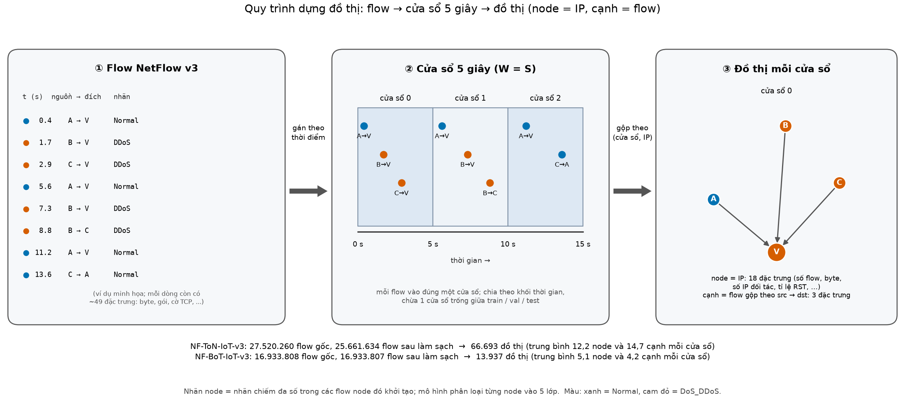

*Nguồn: `reports/figures/gd2_chung_quy_trinh.png` (notebook `12-eda`). Flow trong hình là minh họa; số liệu thật của hai bộ ở chân hình.*

**Node** là một IP trong một cửa sổ, có 18 đặc trưng thống kê (không dùng IP và cổng làm đặc trưng); các đặc trưng đếm, byte, gói, thời gian và khoảng cách giữa flow được log(1 + x) rồi chuẩn hóa bằng scaler fit trên train. **Cạnh** có hướng nguồn → đích, mang 3 đặc trưng (số flow, byte, gói; log1p).

**Bảng 3.3. 18 đặc trưng node và 3 đặc trưng cạnh.**

| Nhóm | Đặc trưng |
|---|---|
| Lưu lượng | `n_out`, `n_in` (số flow ra, vào); `bytes_sent`, `bytes_recv`; `pkts_sent`, `pkts_recv` |
| Đa dạng liên lạc | `uniq_dst`, `uniq_dport` (số đích, số cổng đích khác nhau); `uniq_src` (số nguồn khác nhau) |
| Kích thước và thời gian | `dur_mean` (thời lượng flow trung bình), `pkt_size_mean` (byte/gói), `iat_mean_out` (khoảng cách trung bình giữa các flow ra) |
| Trạng thái kết nối | `noreply_ratio` (tỉ lệ flow không được phản hồi), `rst_ratio` (reset), `est_ratio` (kết nối thiết lập) |
| Giao thức | `tcp_ratio`, `udp_ratio`, `icmp_ratio` |
| Cạnh | `e_flows`, `e_bytes`, `e_pkts` |

*Nguồn: `src/build_graph.py` (`FEATURES`, `EDGE_FEATURES`).*

**Bảng 3.4. Quy mô đồ thị sau khi dựng và chia tập (W = S = 5 giây).**

| | NF-ToN-IoT-v3 | NF-BoT-IoT-v3 |
|---|---|---|
| Số đồ thị (cửa sổ) | 66.693 (train 44.523 / val 10.721 / test 11.449) | 13.937 (9.720 / 2.145 / 2.072) |
| Số node | 811.834 (568.465 / 121.599 / 121.770) | 71.111 (49.820 / 10.626 / 10.665) |
| Node mỗi cửa sổ | median 11, p99 68, lớn nhất 269 | median 5, p99 11, lớn nhất 39 |
| Hash dựng lại (lần 1 = lần 2) | `5575a285…` | `3aa51017…` |
| Kiểm tra (không trùng cửa sổ, gap ≥ 1, không NaN, scaler chỉ fit trên train, tỉ lệ node) | 11/11 đạt | 11/11 đạt |

*Nguồn: `reports/tables/graphs_v2/{nf_ton_iot_v3,nf_bot_iot_v3}/summary.json`, `reports/kaggle/gnn-iot-ids-12-eda/` (kích thước cửa sổ).*

Đồ thị rất nhỏ (trung vị 11 node ở ToN, 5 node ở BoT). Điều này có hệ quả quan trọng ở chương 5: ít cấu trúc để GNN khai thác ngoài việc trung bình đặc trưng hàng xóm.

### 3.4 Phân tích khám phá

**Phân bố lớp và thời gian.** NF-ToN-IoT-v3 có Normal chiếm 61% flow; các lớp xuất hiện theo từng giai đoạn của 7 ngày UTC. NF-BoT-IoT-v3 gần như toàn tấn công (Normal 0,3%), DoS/DDoS dồn vào ngày 04/06.

**Hình 3.2 và 3.3.** Phân bố nhãn gốc và 5 lớp.

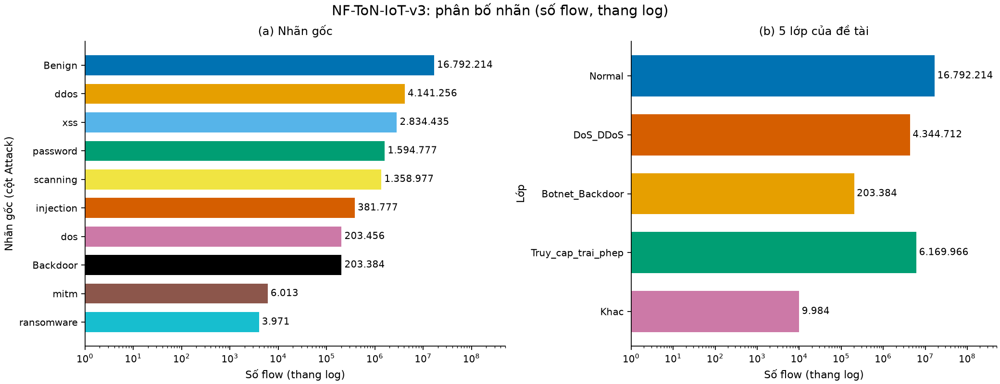
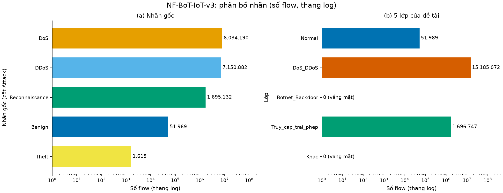

*Nguồn: `reports/figures/gd2_nf_ton_iot_v3_label_dist.png`, `gd2_nf_bot_iot_v3_label_dist.png`.*

**Hình 3.4 và 3.5.** Số flow theo thời gian (mỗi phút), cho thấy tấn công theo giai đoạn.

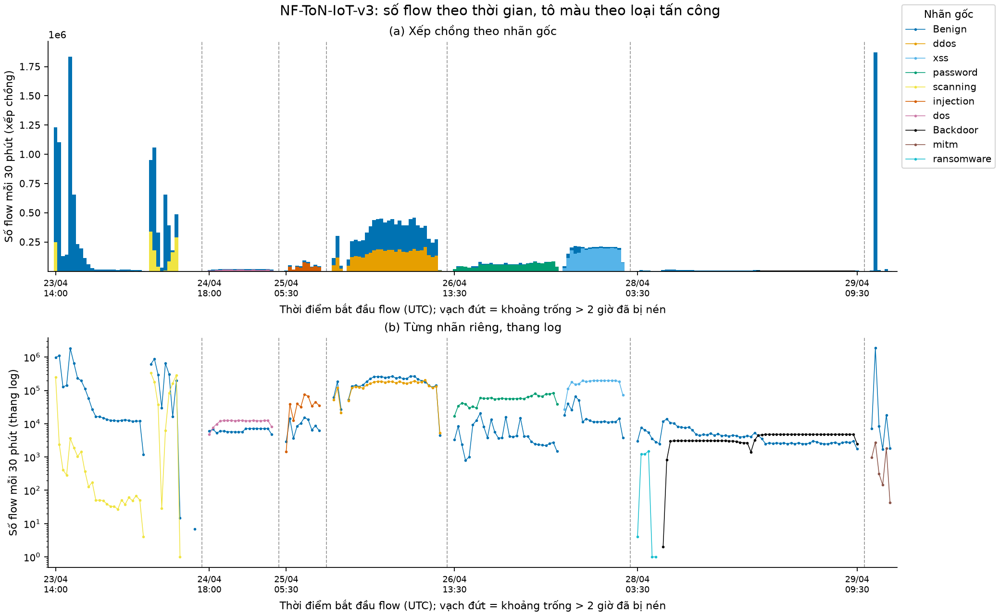
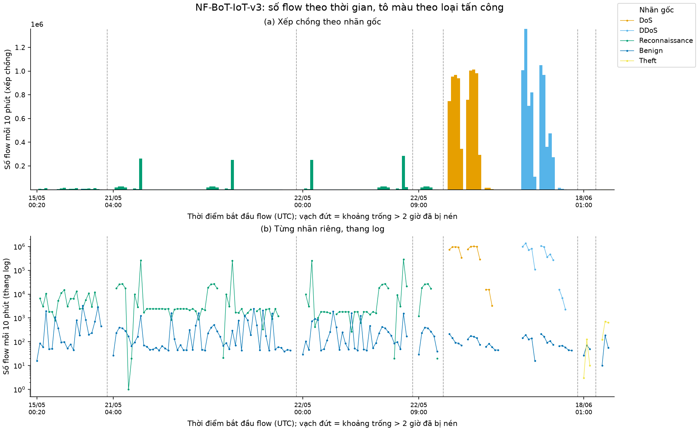

*Nguồn: `reports/figures/gd2_nf_ton_iot_v3_flows_over_time.png`, `gd2_nf_bot_iot_v3_flows_over_time.png`.*

**Thống kê mô tả và đặc trưng phân biệt.** Bảng min, median, max và % thiếu của 49 đặc trưng số mỗi bộ ở `reports/kaggle/gnn-iot-ids-12-eda/gd2_<bộ>_flow_stats.csv`; ToN không thiếu giá trị nào, BoT có hai đặc trưng thiếu 6,213% (`SRC_TO_DST_SECOND_BYTES`, `DST_TO_SRC_SECOND_BYTES`), không đặc trưng nào có giá trị âm. Thông tin tương hỗ (MI) với nhãn 5 lớp cho thấy ba đặc trưng phân biệt tốt nhất:

**Bảng 3.5. Ba đặc trưng mức flow có thông tin tương hỗ (nat) cao nhất với nhãn.**

| NF-ToN-IoT-v3 | MI | NF-BoT-IoT-v3 | MI |
|---|---|---|---|
| `IN_BYTES` | 1,106 | `IN_BYTES` | 0,914 |
| `SRC_TO_DST_AVG_THROUGHPUT` | 0,972 | `SRC_TO_DST_AVG_THROUGHPUT` | 0,892 |
| `OUT_BYTES` | 0,954 | `LONGEST_FLOW_PKT` | 0,846 |

*Nguồn: `reports/kaggle/gnn-iot-ids-12-eda/eda_summary.json`; MI tính trên mẫu cân bằng theo nhãn gốc (tối đa 5.000 flow mỗi nhãn); median và tương quan trên mẫu đều 2%.*

**Hình 3.6 và 3.7.** Thông tin tương hỗ với nhãn.

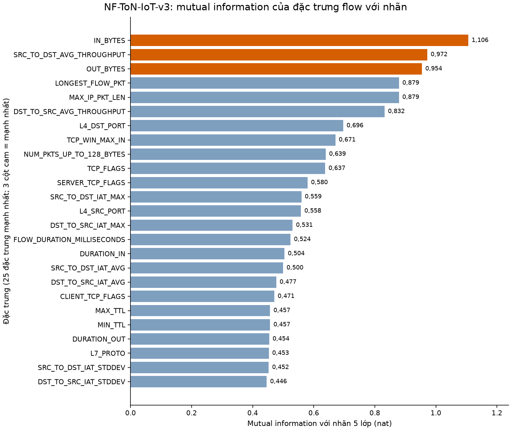
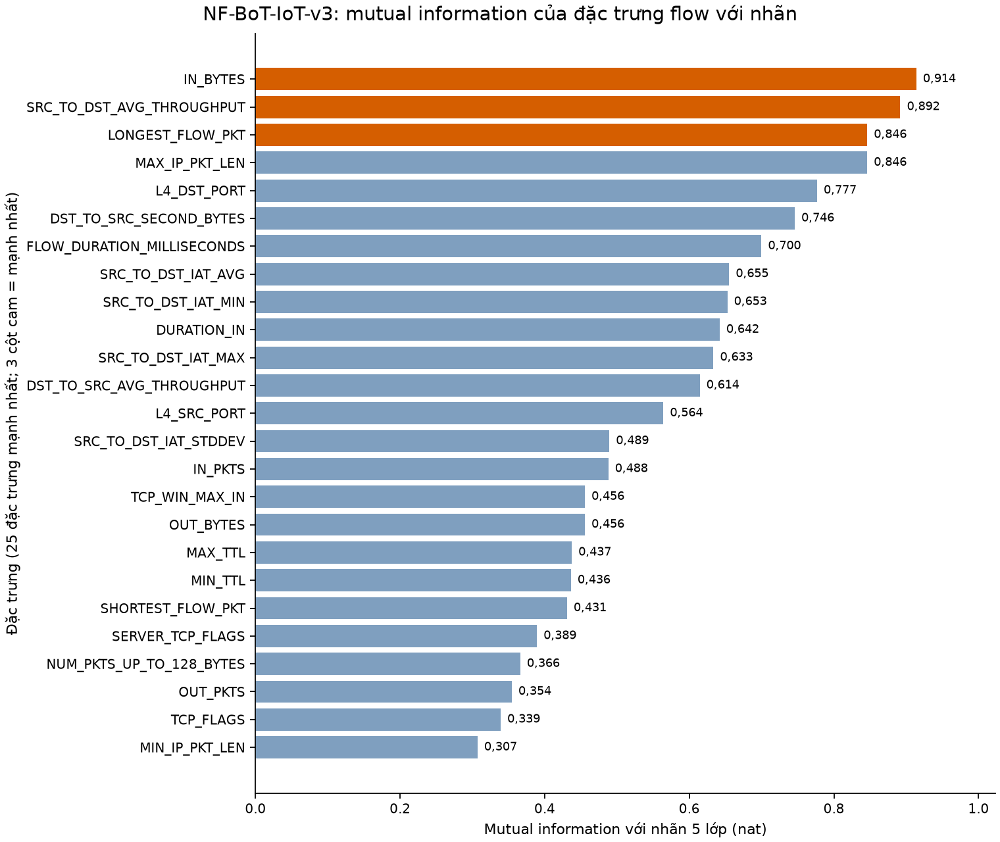

*Nguồn: `reports/figures/gd2_<bộ>_mutual_information.png`. Các hình còn lại của EDA mức flow (boxplot log đặc trưng theo lớp, heatmap tương quan Spearman) ở `reports/figures/gd2_<bộ>_boxplot_log_features.png` và `gd2_<bộ>_corr_heatmap.png`.*

EDA chỉ mô tả, không dùng để chọn cấu hình mô hình. Task 2.1 yêu cầu thêm hình giao thức và cổng; nhóm chỉ làm 5 hình mức flow, nên không có hình riêng cho giao thức và cổng (`L4_DST_PORT` có trong boxplot và MI).

### 3.5 EDA mức đồ thị

**Kích thước cửa sổ và bậc.** Hình 3.8 và 3.9 cho phân bố số node và cạnh mỗi cửa sổ; Hình 3.10 là bậc vào và ra theo lớp.

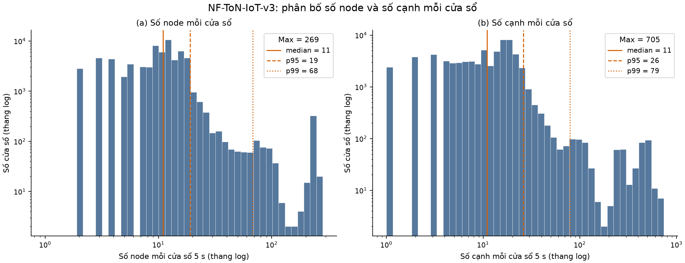
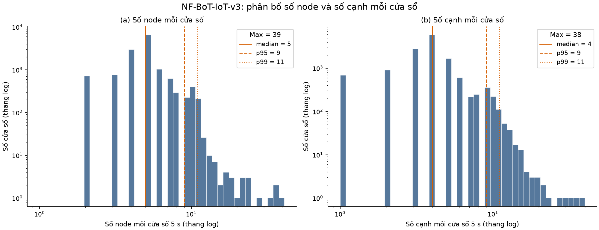
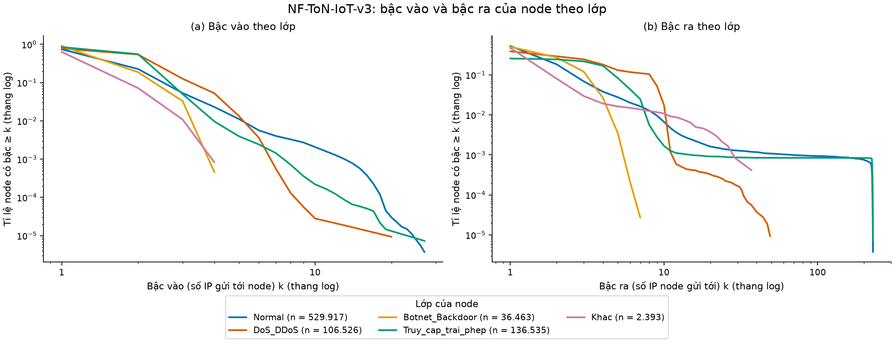

*Nguồn: `reports/figures/gd2_<bộ>_graph_size.png`, `gd2_nf_ton_iot_v3_degree_by_class.png` (hình của BoT: `gd2_nf_bot_iot_v3_degree_by_class.png`).*

Kết quả so sánh bậc **không** chứng minh fan-in và fan-out ở mức node. Bậc là số cặp nguồn → đích trong cửa sổ. NF-ToN-IoT-v3: bậc vào trung bình của DoS_DDoS 1,52 so với Normal 1,08 (gấp 1,40 lần); bậc ra của Truy_cap_trai_phep 1,24 so với 1,13 (gấp 1,09 lần). NF-BoT-IoT-v3: bậc vào của DoS_DDoS 0,62 so với Normal 1,02 (chỉ 0,61 lần). Fan-in và fan-out chỉ xuất hiện ở một số ít cửa sổ (thấy ở các cửa sổ mẫu), không làm lệch phân bố bậc của cả lớp; bậc không phải đặc trưng tách lớp mạnh. *(Nguồn: `reports/kaggle/gnn-iot-ids-12-eda/eda_summary.json`, TASKS 2.2.)*

**Homophily.** Hình 3.11 và 3.12.

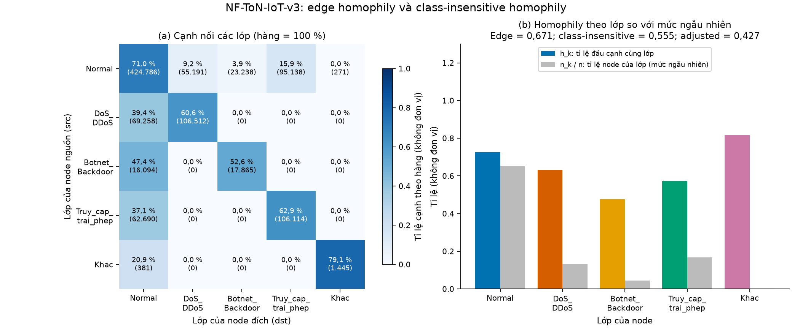
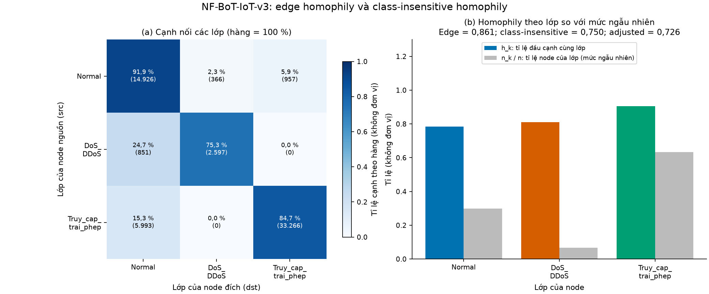

**Bảng 3.6. Homophily của đồ thị đã dựng (toàn bộ cửa sổ).**

| Bộ | Edge homophily | Mức ngẫu nhiên | Class-insensitive | Adjusted |
|---|---|---|---|---|
| NF-ToN-IoT-v3 | 0,671 | 0,474 | 0,555 | 0,427 |
| NF-BoT-IoT-v3 | 0,861 | 0,496 | 0,750 | 0,726 |

*Nguồn: `reports/kaggle/gnn-iot-ids-12-eda/gd2_homophily.csv`, `eda_summary.json`. Ba tập train/val/test lệch nhau không quá 0,07.*

Homophily cao hơn rõ rệt mức ngẫu nhiên, nên gom thông tin hàng xóm có thể giúp làm mượt dự đoán. Tuy vậy 32,9% cạnh ở ToN và 13,9% cạnh ở BoT vẫn nối hai lớp khác nhau (chủ yếu tấn công ↔ Normal), nên hàng xóm không thay được đặc trưng riêng của node. Đây là luận cứ để hybrid giữ cả 18 đặc trưng gốc, và để giải thích kết quả ở mục 5.3.

**Trực quan hóa cửa sổ mẫu.** Hình 3.13 đặt cạnh nhau các cửa sổ Normal, DoS_DDoS và quét.

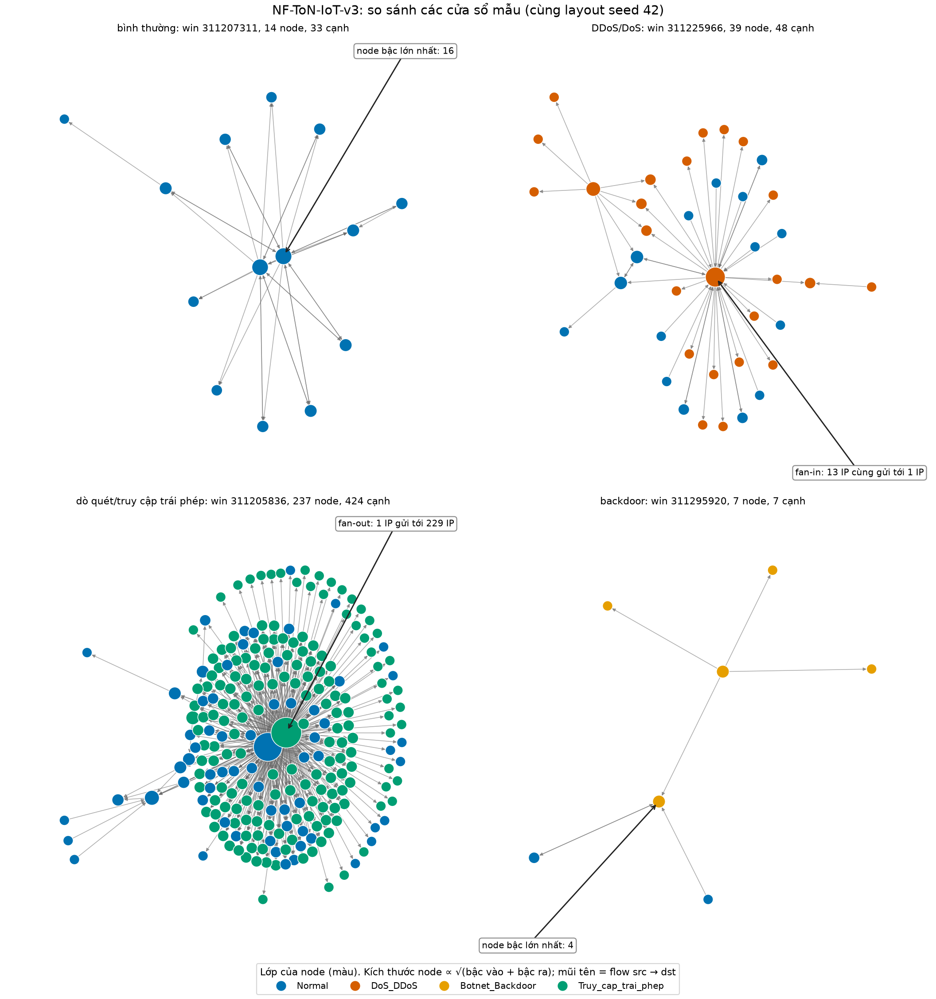

*Nguồn: `reports/figures/gd2_nf_ton_iot_v3_windows_overview.png` (từng cửa sổ riêng: `gd2_nf_ton_iot_v3_window_{normal,ddos,scan,backdoor}.png`; BoT: `gd2_nf_bot_iot_v3_window_{normal,ddos,scan}.png`).*

Cửa sổ lấy từ tập train theo quy tắc cố định, seed layout 42. ToN: fan-in rõ ở DDoS (13 IP cùng gửi tới 1 IP, 39 node) và fan-out rất rõ ở quét (1 IP tới 229 IP, 237 node). BoT: fan-in DDoS rõ (8 IP → 1 IP, 10 node) nhưng fan-out của quét yếu (1 IP → 5 IP, 10 node). Cửa sổ Normal cũng có thể có hình sao (một node nối tới mọi node còn lại), nên hình dạng một mình không phân biệt được tấn công; cửa sổ DDoS và quét trong hình là ví dụ cực đoan, không phải cửa sổ điển hình.

### 3.6 Chia tập theo khối và lý do

Cách chia được chọn (D3, điều chỉnh sau khi thử 12 cấu hình): **`blocked`**, trục thời gian cắt thành **10 khối**, cân theo **số node**, **gap = 1 cửa sổ** ở mọi ranh giới, tỉ lệ node train/val/test 70/15/15. Chọn số khối nhỏ nhất thỏa hai tiêu chí: mỗi lớp có mặt có ≥ 100 node ở train và ≥ 30 node ở val và test; tỉ lệ node trong khoảng 70/15/15 ± 3 điểm %. Việc chọn chỉ dựa trên đếm nhãn, không dùng kết quả mô hình.

**Vì sao không chia thuần theo thời gian (`chronological`).** Vì mỗi loại tấn công chỉ xuất hiện ở một giai đoạn, chia thuần theo thời gian làm val và test thiếu hẳn lớp:

**Bảng 3.7. Số node mỗi lớp khi chia `chronological` (NF-ToN-IoT-v3, gap = 1, cân theo số cửa sổ).**

| Tập | Node | Normal | DoS_DDoS | Botnet_Backdoor | Truy_cap_trai_phep | Khac |
|---|---|---|---|---|---|---|
| train | 700.439 | 456.291 | 106.573 | 197 | 136.570 | 808 |
| val | 65.337 | 43.532 | **0** | 21.805 | **0** | **0** |
| test | 46.524 | 30.463 | **0** | 14.471 | **0** | 1.590 |

*Nguồn: `reports/tables/split_search/split_search_nf_ton_iot_v3.json` (cấu hình `chronological`, không cân node). Với BoT, chia `chronological` thiếu DoS_DDoS (`split_search_nf_bot_iot_v3.json`).*

Không tính được F1 trên 4 lớp chính khi val và test thiếu hai lớp, nên cách chia này không dùng được; `blocked` có đủ lớp ở cả ba tập.

**Bảng 3.8. Số node mỗi lớp theo tập, cách chia được chọn.**

| Bộ | Tập | Node | Normal | DoS_DDoS | Botnet_Backdoor | Truy_cap_trai_phep | Khac |
|---|---|---|---|---|---|---|---|
| NF-ToN-IoT-v3 | train | 568.465 | 355.460 | 68.588 | 26.802 | 117.188 | 427 |
| | val | 121.599 | 88.461 | 16.766 | 4.648 | 10.424 | 1.300 |
| | test | 121.770 | 85.996 | 21.172 | 5.013 | 8.923 | 666 |
| NF-BoT-IoT-v3 | train | 49.820 | 15.578 | 2.855 | — | 31.387 | — |
| | val | 10.626 | 2.918 | 996 | — | 6.712 | — |
| | test | 10.665 | 2.784 | 910 | — | 6.971 | — |

*Nguồn: `reports/tables/graphs_v2/<bộ>/summary.json` (`split_counts`); tỉ lệ node 70,0/15,0/15,0 (ToN) và 70,1/14,9/15,0 (BoT).*

**Hạn chế của cách chia.** Các tấn công diễn ra theo từng ngày, nên `blocked` đo khả năng tổng quát hóa sang các đoạn thời gian xen kẽ, không phải dự đoán hoàn toàn trong tương lai. Ranh giới giữa các tập chỉ cách nhau 1 cửa sổ (5 giây). Val và test là các khối khác nhau nên điểm của hai tập không so trực tiếp được (ví dụ LightGBM ToN có F1-macro val 0,8984 nhưng test 0,9199).

---

## Chương 4. Phương pháp và thực nghiệm

### 4.1 Quy trình và nguyên tắc

Mọi mô hình dùng chung `split.json`, cùng 3 seed (42, 43, 44) và cùng module `src/evaluate.py` (kết quả ghi vào `reports/tables/results.csv` với 20 cột). Tinh chỉnh chỉ trên val. Các bước: baseline và GNN đơn trên val (GĐ A–E) → hybrid (GĐ F) → ablation, bản cải tiến, hiệu chỉnh ngưỡng (GĐ G) → đóng băng bằng tag `freeze-v1` (commit `abcb5f8`), chạy test đúng một lần cho 63 mục (bộ, mô hình, seed), mỗi mục ghi hai dòng (argmax và ngưỡng) (GĐ H). Từ sau tag không sửa mô hình, cấu hình hay ngưỡng theo kết quả test.

### 4.2 Baseline học máy và học sâu

Năm baseline huấn luyện trên 18 đặc trưng node (không dùng cạnh): hồi quy logistic, RF, XGBoost, LightGBM và MLP. Tìm cấu hình trên val, mỗi mô hình ≤ 30 lần thử (thực tế 3/3/3/3/2 lần thử cho LR/RF/XGBoost/LightGBM/MLP).

**Bảng 4.1. Cấu hình baseline được chọn trên val.**

| Mô hình | NF-ToN-IoT-v3 | NF-BoT-IoT-v3 |
|---|---|---|
| LR | C = 1,0, class_weight balanced | C = 10,0 |
| RF | n = 200, độ sâu không giới hạn | n = 100, độ sâu 12 |
| XGBoost | n = 300, độ sâu 8, lr 0,1 | n = 200, độ sâu 6 |
| LightGBM | n = 300, 63 lá, lr 0,1 | n = 200, 31 lá |
| MLP | (64, 64), dừng sớm | (64, 64) |

*Nguồn: `docs/gnn_ids/freeze_list.md` mục 2 (từ `baseline_search_<bộ>.json`).*

### 4.3 GNN đơn: GCN, GraphSAGE, GAT

Cả ba dùng cùng khung: 2 lớp tích chập (mỗi lớp đầu ra 64 = 16 × 4 head, GCN và GraphSAGE cùng độ rộng 64 để so công bằng), ELU, dropout 0,2, một lớp tuyến tính ra 5 lớp. Đồ thị có hướng nên node nguồn tấn công không nhận được thông điệp từ nạn nhân; vì vậy mô hình thêm cạnh ngược với cùng đặc trưng cạnh trước khi truyền thông điệp. Chỉ GAT dùng đặc trưng cạnh và attention nhiều head. Huấn luyện bằng Adam (lr 5e-3, weight decay 1e-4 [44]), tối đa 40 epoch, dừng sớm theo F1-macro val (patience 6), batch 128 đồ thị, hàm mất mát cross-entropy có trọng số lớp cân bằng. Tinh chỉnh trên val ≤ 20 lần thử mỗi mô hình (GCN 6, GraphSAGE 6, GAT 10); cấu hình mặc định gần tốt nhất nên được giữ.

**Bảng 4.2. Số tham số của GAT chính (NF-ToN-IoT-v3), 11.717 tham số, 50,6 KB.**

| Thành phần | Công thức | Tham số |
|---|---|---|
| Lớp GAT 1 (`convs.0`) | `lin_l` + `lin_r`: 2 × (18 × 64 + 64); `lin_edge`: 3 × 64; `att`: 64; `bias`: 64 | 2.752 |
| Lớp GAT 2 (`convs.1`) | 2 × (64 × 64 + 64); `lin_edge` 192; `att` 64; `bias` 64 | 8.640 |
| Đầu phân loại (`head`) | 64 × 5 + 5 | 325 |
| **Tổng** | | **11.717** |

*Nguồn: `reports/kaggle/gnn-iot-ids-16d-ablation-ton/gat_param_table_nf_ton_iot_v3.csv`; công thức đối chiếu với `src/models.py`. BoT (3 lớp): 11.587 tham số, 50,1 KB.*

Kết quả trên val (cấu hình dùng cho hybrid và cho bảng test):

**Bảng 4.3. F1-macro trên val (3 seed) của baseline, GNN đơn và các biến thể hybrid.**

| Mô hình | NF-ToN-IoT-v3 | NF-BoT-IoT-v3 |
|---|---|---|
| LR | 0,6956 | 0,8923 |
| RF | 0,8988 | 0,9380 |
| XGBoost | 0,8971 | 0,9377 |
| LightGBM | 0,8984 | 0,9388 |
| MLP | 0,9100 ± 0,0033 | 0,9294 ± 0,0035 |
| GCN | 0,8726 ± 0,0081 | 0,9147 ± 0,0040 |
| GraphSAGE | **0,9146 ± 0,0008** | 0,9339 ± 0,0004 |
| GAT | 0,9079 ± 0,0069 | 0,9320 ± 0,0009 |
| Hybrid, OOF 5 nhóm liên tiếp (đặc tả gốc) | 0,6471 ± 0,0080 | 0,7141 ± 0,1710 |
| Hybrid, không OOF | 0,9116 ± 0,0353 | 0,9351 ± 0,0003 |
| Hybrid, OOF liên tiếp + trung bình 5 góc | 0,6725 ± 0,0041 | 0,7426 ± 0,1518 |
| Hybrid, stacking bằng xác suất lớp (liên tiếp) | 0,7780 ± 0,0907 | 0,8830 ± 0,0179 |
| **Hybrid chính, OOF xen kẽ + trung bình 5 góc (D13)** | **0,9326 ± 0,0009** | 0,9357 ± 0,0019 |

*Nguồn: `reports/kaggle/gnn-iot-ids-15c-compare-check/compare_val_<bộ>.csv` (dựng lại chỉ từ file trong repo). Std bằng 0 hoặc không ghi ở một số baseline xác định (LR, XGBoost, LightGBM bộ BoT) vì ba seed cho cùng kết quả. Một số hàng baseline ToN do Kaggle mount có nội dung khác bản trong repo, báo cáo dùng bản repo (xem Phụ lục B).*

### 4.4 Hybrid GAT + LightGBM

**Thiết kế ban đầu và vì sao thất bại.** Đặc tả ban đầu (task 5.7): chia train thành 5 nhóm khối thời gian **liên tiếp**; với mỗi nhóm, GAT huấn luyện trên 4 nhóm còn lại rồi sinh embedding cho nhóm đó; val và test dùng GAT huấn luyện trên toàn bộ train. Kết quả trên val rất tệ (Bảng 4.3 hàng "OOF 5 nhóm liên tiếp"): F1-macro 0,647 ± 0,008 (ToN) và 0,714 ± 0,171 (BoT), tệ hơn cả bản không OOF.

Nhóm đã thử ba cách sửa trước khi tìm ra nguyên nhân: (i) trung bình xác suất qua 5 GAT nhóm (`oofavg`): ToN 0,6725, BoT 0,7426; (ii) stacking bằng xác suất lớp 5 chiều thay cho embedding 64 chiều (`stack`): ToN 0,778 ± 0,091, BoT 0,883 ± 0,018; (iii) chẩn đoán từng "góc nhìn" (mỗi GAT nhóm cho một embedding val): chỉ góc cuối cho F1 ngang LightGBM, các góc khác thấp hơn nhiều. Nguyên nhân được xác định từ trường `classes_missing_in_fit` trong `hybrid_search_oofavg_<bộ>.json`: mỗi loại tấn công chỉ xuất hiện ở một giai đoạn thời gian, nên nhóm cuối của train là nơi duy nhất có DoS_DDoS (BoT) hoặc Botnet_Backdoor và Khac (ToN). GAT huấn luyện trên 4 nhóm đầu **chưa từng thấy các lớp đó** (F1 val riêng của GAT này chỉ 0,57 ở BoT và 0,67 ở ToN, bốn GAT còn lại 0,89–0,94), nên embedding out-of-fold của nhóm cuối vô nghĩa và làm LightGBM học sai. Đây là lỗi của cách chia nhóm liên tiếp trên dữ liệu không dừng, không phải lỗi của ý tưởng hybrid. (Giả thuyết trước đó "mỗi GAT có dấu vân tay embedding riêng" đã bị thay thế bởi nguyên nhân này.)

**Thiết kế dùng cho báo cáo (quyết định D13, 15/11/2026).** Train được cắt thành 5 × 20 = 100 khối liên tiếp theo thời gian, khối $i$ thuộc nhóm $i \bmod 5$ (**out-of-fold xen kẽ**); không GAT nhóm nào thiếu lớp chính. Mỗi GAT nhóm huấn luyện trên 4 nhóm còn lại; embedding train của mỗi nhóm lấy từ GAT không thấy nhóm đó. Với val và test, mỗi GAT nhóm cho một embedding, LightGBM dự đoán xác suất trên mỗi "góc nhìn", rồi **lấy trung bình 5 xác suất**. Mô hình này (`hybrid_gat_lgbm_oofavg_il`) là **hybrid chính**.

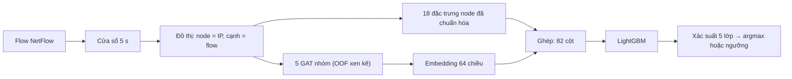

**Hình 4.1.** Sơ đồ hybrid chính (sơ đồ do nhóm vẽ; không phải kết quả thực nghiệm).

Chi phí của thiết kế xen kẽ: 5 GAT thay vì 1, nên trên ToN hybrid chính có 144.278–144.715 tham số (GAT + số lá LightGBM) và file 9,7 MB, vượt ngưỡng nhẹ; phần lớn là file LightGBM (LightGBM baseline ToN cũng 10 MB). Trên BoT: 62.435 tham số, 776 KB, đạt ngưỡng nhẹ.

### 4.5 Hybrid nhẹ

Từ hybrid chính, nhóm quét một đường Pareto: số GAT dùng khi suy luận (5, 3, 2, 1, hoặc 1 GAT huấn luyện trên toàn train) × `n_estimators` LightGBM ∈ {25, 50, 100} × `num_leaves` ∈ {7, 15, 31} (50 điểm cho ToN, 45 điểm cho BoT). **Quy tắc chọn bản nhẹ** (cố định trước khi chạy test): trong các điểm có ≤ 100.000 tham số và ≤ 1.024 KB (kích thước là max trên 3 seed), lấy điểm có F1-macro val cao nhất. Kết quả ở mục 5.4. Trên ToN, bản nhẹ là **2 GAT nhóm + LightGBM (n = 100, 15 lá)**; trên BoT, hybrid chính đã đạt ngưỡng nhẹ nên bản nhẹ trùng bản chính.

### 4.6 Phương án (c): LightGBM + đặc trưng hàng xóm tính tay

Để tách riêng đóng góp của thông tin hàng xóm khỏi đóng góp của embedding GAT, nhóm thêm phương án (c): LightGBM trên 36 cột = 18 đặc trưng node + trung bình 18 đặc trưng của các node kề (không phân biệt hướng, mỗi hàng xóm đếm một lần; tính tay, không học). Phương án (c) được đưa vào danh sách chạy test theo quyết định của nhóm trưởng ngày 16/11/2026, trước khi tạo tag, vì nếu thiếu số test của (c) thì minh chứng "hybrid hơn baseline" thiếu trung thực.

### 4.7 Bản cải tiến của GAT: thử nghiệm không thành công

Ba bản cải tiến được thử trên NF-ToN-IoT-v3 (val, 3 seed), mỗi bản chỉ đổi một yếu tố hoặc cặp yếu tố: focal loss ($\gamma = 2$) [41], đường tắt residual [42] kèm LayerNorm [43], và cả hai. Tiêu chí công nhận (task 5.4): tăng F1-macro hoặc recall Botnet_Backdoor lớn hơn 2 lần std; hoặc giảm ≥ 30% tham số hoặc độ trễ mà F1-macro giảm ≤ 1 điểm %.

**Bảng 4.4. Bản cải tiến GAT trên val (NF-ToN-IoT-v3).**

| Bản | F1-macro | Δ so với chính | Recall Botnet_Backdoor | Tham số | Công nhận |
|---|---|---|---|---|---|
| GAT chính | 0,9065 ± 0,0019 | — | 0,9994 | 11.717 | — |
| focal loss | 0,8940 ± 0,0007 | −0,0125 | 0,9994 | 11.717 | Không |
| residual + LayerNorm | 0,9113 ± 0,0027 | +0,0048 (chưa tới 2 × 0,0027 = 0,0054) | 0,9987 | 13.125 | Không |
| focal + residual + LayerNorm | 0,8992 ± 0,0063 | −0,0073 | 0,9989 | 13.125 | Không |

*Nguồn: `reports/kaggle/gnn-iot-ids-16c-aggregate/improved_gat.csv`. Chưa thử đặc trưng thời gian và quantization/pruning.*

Không bản nào đạt tiêu chí nên **không công nhận** và không đưa vào hybrid; báo cáo ghi là thử nghiệm không thành công. Một quan sát ngoài tiêu chí: một số cấu hình ablation giảm ≥ 30% tham số mà F1-macro giảm ≤ 1 điểm % (1 lớp: −74% tham số, F1 −0,0023; hidden 8: −67%, −0,0050; 2 head: −67%, −0,0092), nhưng đó là cấu hình ablation chứ không phải bản cải tiến, và chưa được kiểm trong hybrid.

### 4.8 Hiệu chỉnh ngưỡng quyết định

Với mỗi mô hình, điểm tấn công của node là $s = 1 - P(\text{Normal})$. Chế độ **ngưỡng**: node bị coi là tấn công khi $s > t$, và khi đó lớp dự đoán là lớp tấn công có xác suất cao nhất; ngược lại là Normal. Ngưỡng $t$ là **giá trị nhỏ nhất** (tức recall tấn công lớn nhất) sao cho FPR trên val ≤ 4,08%, chọn riêng cho từng (bộ, mô hình, seed) và **giữ nguyên khi chạy test**. Chế độ **argmax** không dùng ngưỡng. Báo cáo trình bày cả hai chế độ vì chúng trả lời hai câu hỏi khác nhau: argmax là hành vi mặc định của mô hình; ngưỡng là cách vận hành để đáp ứng chỉ tiêu FPR.

Mọi mô hình đều đưa được FPR val về ≤ 4,08%, nhưng **không mô hình nào đạt recall val ≥ 95% cùng lúc** (ToN: hybrid chính 91,9%, hybrid nhẹ 90,2%, GraphSAGE 91,7%; BoT: chỉ 29–38%). Ở test, ToN đạt recall ≥ 95% (mục 5.1): khác biệt này là khác biệt giữa val và test của cách chia xen kẽ, không dùng để chỉnh gì.

### 4.9 Môi trường thực nghiệm

Mọi huấn luyện, xử lý dữ liệu, đánh giá và tổng hợp số liệu chạy trên Kaggle (tài khoản của nhóm, GPU **Tesla T4**, CPU 4 nhân; D12). Máy cá nhân chỉ sửa mã, đẩy lên GitHub, điều khiển Kaggle qua API và tải về file kết quả nhỏ (`.csv`, `.json`, `.png`). Kiểm tra môi trường trên Kaggle (notebook `00-env-check`): Python 3.13, PyTorch 2.11.0 (CUDA 12.8) có sẵn, Tesla T4. Mã nguồn: PyTorch Geometric (GATv2Conv), LightGBM; phiên bản ghi trong `requirements.txt`. Test chạy trên CPU (0 giờ GPU); độ trễ đo trên CPU Kaggle giới hạn 1 luồng (D7 điều chỉnh).

**Bảng 4.5. Giờ GPU Tesla T4 đã dùng (notebook có `run_info.json`).**

| Notebook | Nội dung | Thời gian | Giờ GPU |
|---|---|---|---|
| `15-hybrid` | Hybrid bản đặc tả (OOF liên tiếp và không OOF), 2 bộ | 3.427 s | 0,952 |
| `15b-hybrid-oofavg` | Thử sửa bằng trung bình qua 5 GAT nhóm | 2.974 s | 0,826 |
| `15f-hybrid-il-ton` | Hybrid OOF xen kẽ trên ToN | 2.494 s | 0,693 |
| `16-ablation` (bản 3) | Ablation GAT và bản cải tiến, ToN | 3.841 s | 1,067 |
| `16f-windows-gat` | GAT với W = 1, 2, 10 giây | 1.713 s | 0,476 |
| Hai lần chạy `16-ablation` hỏng ở pytest | | | 0,078 |
| **Tổng** | | | **≈ 4,09** |

*Nguồn: `reports/kaggle/<notebook>/run_info.json` (năm dòng đầu cộng lại 4,014 giờ); hai lần chạy hỏng (0,039 + 0,039) ghi ở `docs/gnn_ids/LO_TRINH_KAGGLE.md` mục 6.*

Các notebook còn lại (đồ thị, EDA, baseline, ngưỡng, test, tổng hợp) chạy trên CPU: khoảng 7,6 giờ CPU trên 20 notebook có `run_info.json`. Tổng giờ GPU 4,09 giờ thấp xa hạn mức 30 giờ mỗi tuần (ghi chú: tài khoản dùng chung với một dự án khác, và notebook `07-train-gnn` của GĐ A chạy trên T4 nhưng không có `run_info.json` nên giờ GPU của nó chưa được tính; con số 4,09 là cận dưới). Chi tiết ở [Phụ lục C](#phụ-lục-c-các-notebook-kaggle-và-giờ-gpu).

---

## Chương 5. Kết quả

Mọi số trong chương này là trên **tập test**, 3 seed, trừ khi ghi rõ là val. Bộ chính là NF-ToN-IoT-v3; NF-BoT-IoT-v3 là bộ thứ hai (mọi chỉ tiêu nghiệm thu chỉ tính chính thức trên bộ chính).

### 5.1 So sánh trên tập test

**Bảng 5.1. NF-ToN-IoT-v3, test (121.770 node: 85.996 Normal, 35.774 tấn công): F1-macro (4 lớp chính), FPR và recall tấn công ở hai chế độ.**

| Mô hình | F1 argmax | FPR argmax | Recall argmax | F1 ngưỡng | FPR ngưỡng | Recall ngưỡng |
|---|---|---|---|---|---|---|
| LR | 0,7180 | 32,90% | 96,00% | 0,8156 | 3,59% | 74,96% |
| RF | 0,9218 ± 0,0002 | 7,10% | 98,24% | 0,9542 ± 0,0002 | 2,02% | 93,59% |
| XGBoost | 0,9199 | 7,49% | 98,46% | 0,9611 | 2,04% | 95,08% |
| LightGBM | 0,9199 ± 0,0002 | 7,36% | 98,25% | 0,9601 ± 0,0001 | 2,07% | 94,81% |
| MLP | 0,9422 ± 0,0039 | **3,53%** | 94,98% | 0,9575 ± 0,0016 | 1,79% | 93,86% |
| (c) LightGBM + hàng xóm | **0,9477 ± 0,0003** | 4,61% | 98,30% | 0,9653 ± 0,0003 | 2,51% | 96,89% |
| GCN | 0,9018 ± 0,0083 | 10,90% | 98,02% | 0,8757 ± 0,0304 | 2,26% | 81,19% |
| GraphSAGE | 0,9327 ± 0,0007 | 7,64% | 99,19% | 0,9600 ± 0,0041 | 3,15% | 96,70% |
| GAT | 0,9270 ± 0,0021 | 8,17% | 98,93% | 0,9572 ± 0,0024 | 2,53% | 95,20% |
| **Hybrid chính** | 0,9472 ± 0,0007 | 4,20% | 97,65% | **0,9677 ± 0,0005** | 1,88% | 96,71% |
| **Hybrid nhẹ** | 0,9341 ± 0,0043 | 5,69% | 97,83% | 0,9588 ± 0,0011 | 2,27% | 95,65% |

*Nguồn: `reports/tables/summary_test.csv`. Ngưỡng 4,08% được áp dụng cho FPR; chữ đậm là giá trị tốt nhất của cột F1 hoặc FPR argmax. Ô không ghi std nghĩa là std bằng 0 ở 4 chữ số thập phân.*

**Hình 5.1.** F1-macro và FPR của mọi mô hình trên test (cột nhạt = argmax, cột đậm = ngưỡng; vạch 4,08%).

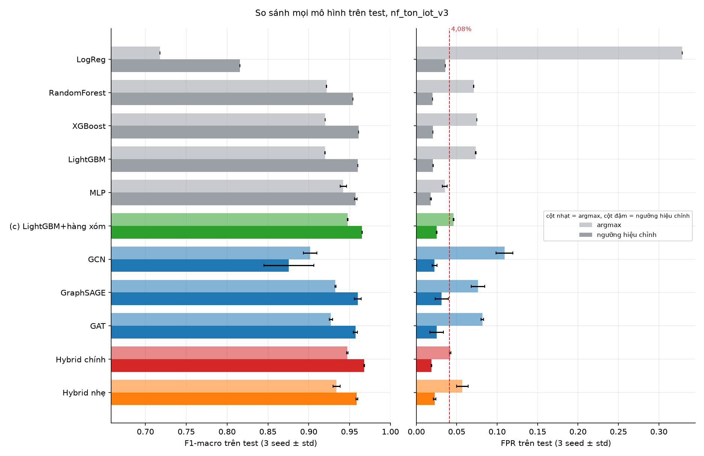

*Nguồn: `reports/figures/gd6_bar_f1_fpr_nf_ton_iot_v3.png`.*

Đọc Bảng 5.1:

- **Chế độ ngưỡng:** hybrid chính có F1-macro cao nhất (0,9677), cao hơn (c) 0,0025 và GraphSAGE 0,0078.
- **Chế độ argmax:** (c) (0,9477) nhỉnh hơn hybrid chính (0,9472) 0,0005, chênh này nằm trong sai số, nên hai mô hình ngang nhau; hybrid không phải mô hình cao nhất ở chế độ này.
- Ở argmax, MLP có FPR thấp nhất (3,53%, đạt ≤ 4,08%) nhưng recall 94,98% (chưa tới 95%); không baseline nào đạt cả FPR ≤ 4,08% và recall ≥ 95% ở argmax.

**Bảng 5.2. NF-BoT-IoT-v3, test (10.665 node: 2.784 Normal, 7.881 tấn công; 3 lớp).**

| Mô hình | F1 argmax | FPR argmax | Recall argmax | F1 ngưỡng | FPR ngưỡng | Recall ngưỡng |
|---|---|---|---|---|---|---|
| LR | 0,8462 | 24,10% | 88,99% | 0,5819 | 5,35% | 30,29% |
| RF | 0,9039 ± 0,0005 | 17,88% | 92,97% | 0,6605 ± 0,0060 | 1,57% | 38,99% |
| XGBoost | 0,8987 | 17,85% | 92,42% | 0,6567 | 1,90% | 39,20% |
| LightGBM | **0,9291** | 18,10% | 96,79% | 0,6949 | 2,26% | 45,25% |
| MLP | 0,9123 ± 0,0109 | 20,25% | 95,05% | 0,6340 ± 0,0329 | 0,74% | 34,07% |
| (c) LightGBM + hàng xóm | 0,8900 | 17,31% | 90,01% | 0,6550 | 1,15% | 37,93% |
| GCN | 0,8801 ± 0,0072 | 18,63% | 89,35% | 0,6003 ± 0,0455 | 0,83% | 29,56% |
| GraphSAGE | 0,8871 ± 0,0027 | 18,77% | 90,53% | 0,6450 ± 0,0023 | 1,16% | 36,72% |
| GAT | 0,8885 ± 0,0033 | 18,73% | 90,69% | 0,6423 ± 0,0063 | 1,23% | 36,00% |
| **Hybrid chính (= nhẹ)** | 0,9164 ± 0,0012 | 17,97% | 94,79% | **0,7084 ± 0,0123** | 1,19% | 47,47% |

*Nguồn: `reports/tables/summary_test.csv`. Std của LR, XGBoost, LightGBM, (c) bằng 0 vì ba seed cho cùng kết quả.*

Trên NF-BoT-IoT-v3, **LightGBM tốt hơn hybrid ở argmax** (0,9291 so với 0,9164); hybrid cao nhất ở chế độ ngưỡng nhưng recall chỉ 47,5%. FPR argmax của mọi mô hình quanh 17–24% (mục 5.8).

**Bảng 5.3. Kích thước, độ nhẹ và độ trễ (test; độ trễ đo sơ bộ).**

| Mô hình | NF-ToN-IoT-v3: tham số / KB / ms | NF-BoT-IoT-v3: tham số / KB / ms |
|---|---|---|
| LR | 95 / 1,1 / 0,29 | 57 / 0,9 / 0,25 |
| RF | 4.817.813 / 493.820 / 25,6 | 69.435 / 6.389 / 12,7 |
| XGBoost | 254.814 / 9.429 / 5,66 | 35.584 / 1.571 / 1,24 |
| LightGBM | 187.500 / 10.317 / 4,15 | 36.600 / 2.058 / 1,46 |
| MLP | 5.701 / 75,4 / 0,61 | 5.571 / 73,5 / 0,59 |
| (c) | 173.526 / 9.637 / 5,36 | 8.700 / 521 / 2,54 |
| GCN | 5.701 / 25,1 / 1,19 | 5.571 / 24,6 / 1,26 |
| GraphSAGE | 10.949 / 46,0 / 0,70 | 10.819 / 45,5 / 0,61 |
| GAT | 11.717 / 50,6 / 2,15 | 11.587 / 50,1 / 1,98 |
| Hybrid chính | **144.518 / 9.747 / 24,4** | 62.435 / 776 / 13,4 |
| Hybrid nhẹ | **30.934 / 986 / 7,32** | (trùng hybrid chính) |

*Nguồn: `reports/tables/summary_test.csv` (cột `n_params`, `size_kb`, `infer_ms_per_window`; hybrid: tham số = tham số các GAT + số lá LightGBM). Độ trễ: p95 của 200 lần chạy trên 1 cửa sổ trung vị, CPU Kaggle 1 luồng — **đo sơ bộ**, chưa phải ≥ 1.000 cửa sổ end-to-end (mục 5.9).*

**Các hình bổ sung:** ROC và PR (Hình 5.2), F1 theo lớp (Hình 5.3), F1 theo số tham số, kích thước và độ trễ (Hình 5.4–5.6), thời gian huấn luyện (Hình 5.7) và ma trận nhầm lẫn của hybrid chính (Hình 5.8).

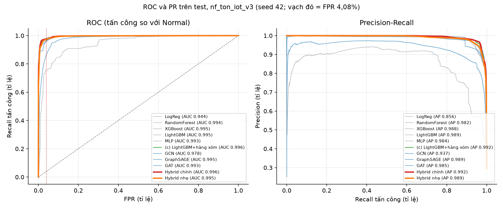
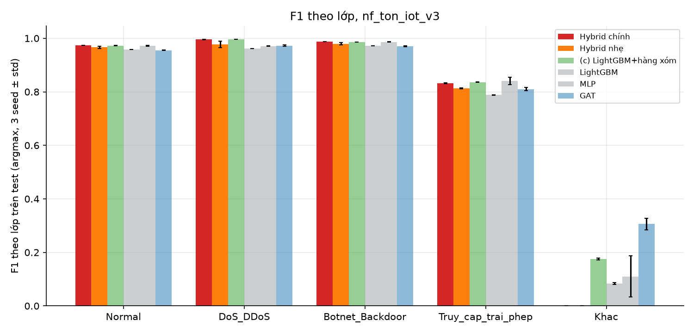
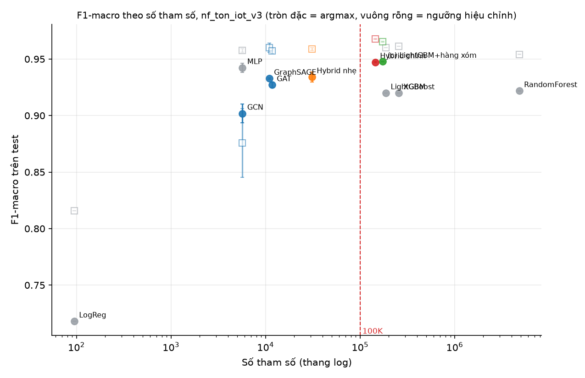
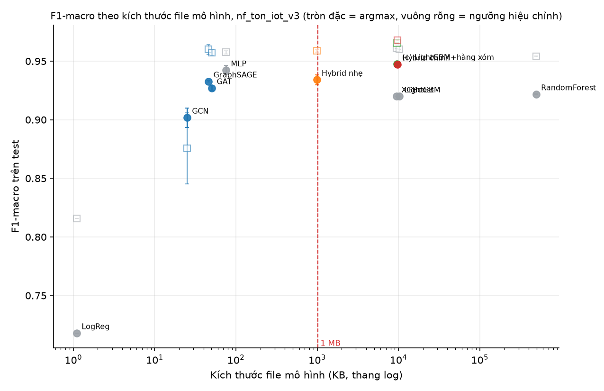
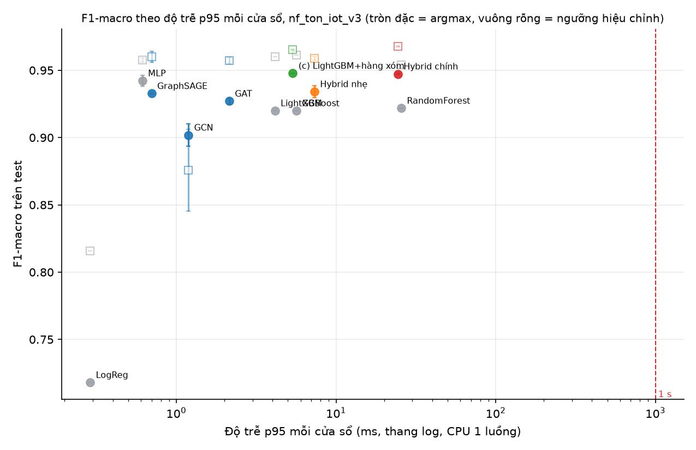
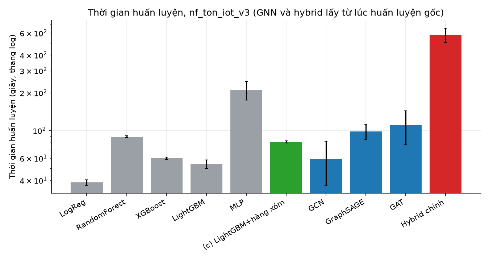
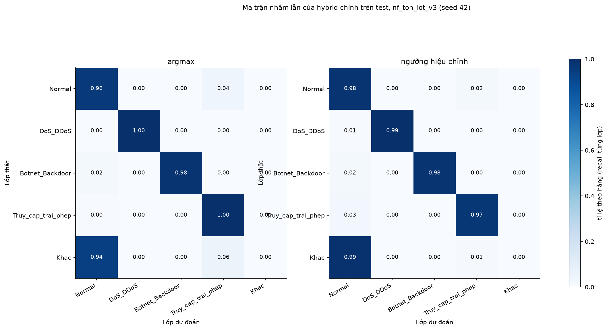

*Nguồn: `reports/figures/gd6_<tên>_nf_ton_iot_v3.png`; hình tương ứng của BoT: `gd6_<tên>_nf_bot_iot_v3.png` (Hình 5.9: `gd6_bar_f1_fpr_nf_bot_iot_v3.png`, `gd6_confusion_hybrid_nf_bot_iot_v3.png`). Đường huấn luyện: `gd6_training_curves_<bộ>.png`.*

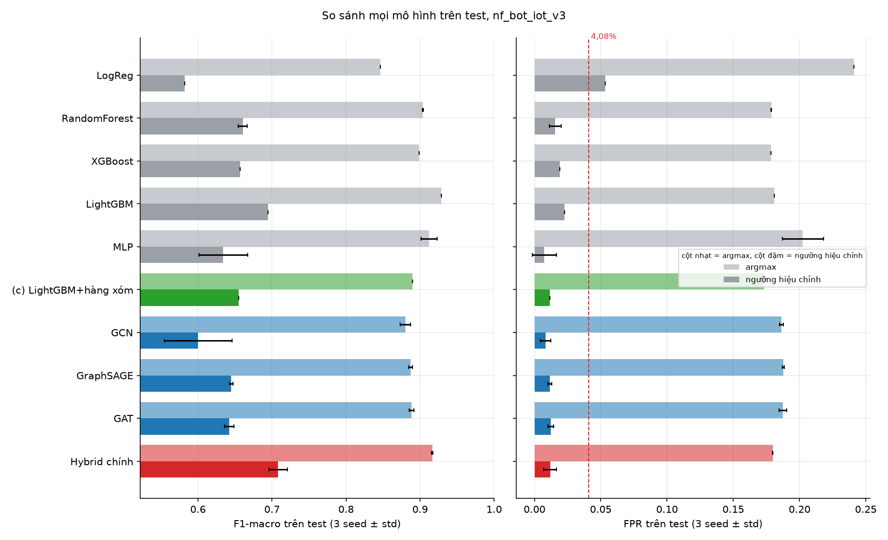

### 5.2 Kiểm định McNemar và minh chứng hybrid so với baseline

Mô hình "tốt nhất" của từng nhóm được chọn theo F1-macro **val** (không nhìn test): ToN: ML = RF, GNN đơn = GraphSAGE; BoT: ML = LightGBM, GNN đơn = GraphSAGE. Nhóm MLP và (c) là các mô hình đơn.

**Bảng 5.4. Hybrid chính so với từng nhóm baseline, NF-ToN-IoT-v3 (test).**

| Nhóm baseline | Chế độ | ΔF1 (hybrid − baseline) | 2 × std | McNemar (số seed hybrid tốt hơn / 3) | Kết luận |
|---|---|---|---|---|---|
| ML tốt nhất (RF) | argmax | +0,0254 | 0,0014 | 3 | **Vượt** |
| | ngưỡng | +0,0136 | 0,0010 | 3 | **Vượt** |
| MLP | argmax | +0,0050 | 0,0079 | 3 | Chưa đủ (chênh F1 nhỏ hơn 2 std) |
| | ngưỡng | +0,0102 | 0,0031 | 3 | **Vượt** |
| (c) LightGBM + hàng xóm | argmax | −0,0005 | 0,0014 | 3 (nghiêng về hybrid ở độ chính xác) | Chưa đủ; F1 ngang nhau |
| | ngưỡng | +0,0025 | 0,0010 | 3 | **Vượt** (chênh nhỏ) |
| GNN đơn tốt nhất (GraphSAGE) | argmax | +0,0145 | 0,0014 | 3 | **Vượt** |
| | ngưỡng | +0,0078 | 0,0083 | 3 | Chưa đủ (chênh nhỏ hơn 2 std) |

*Nguồn: `reports/tables/conclusions.csv`, `reports/tables/mcnemar.csv`. "Vượt" theo quy ước ở mục 2.6.*

**Kết luận cho bộ chính.** Hybrid chính vượt ML tốt nhất ở cả hai chế độ; vượt MLP và (c) **chỉ ở chế độ ngưỡng**; vượt GraphSAGE chỉ ở argmax. Hybrid chính **không vượt mọi nhóm baseline ở bất kỳ chế độ nào** (Bảng 5.4 luôn có ít nhất một hàng "chưa đủ"), nên chỉ tiêu "hybrid > baseline tốt nhất" **không đạt**: 2/4 nhóm ở argmax và 3/4 nhóm ở ngưỡng (`targets.csv`).

**Bảng 5.5. Hybrid nhẹ so với từng nhóm baseline, NF-ToN-IoT-v3 (test).**

| Nhóm baseline | Chế độ | ΔF1 | 2 × std | Kết luận |
|---|---|---|---|---|
| ML tốt nhất (RF) | argmax / ngưỡng | +0,0123 / +0,0046 | 0,0086 / 0,0022 | **Vượt** / **Vượt** |
| MLP | argmax / ngưỡng | −0,0081 / +0,0013 | 0,0086 / 0,0031 | Chưa đủ / Chưa đủ |
| (c) | argmax / ngưỡng | −0,0136 / −0,0065 | 0,0086 / 0,0022 | **(c) vượt** / **(c) vượt** |
| GNN đơn tốt nhất (GraphSAGE) | argmax / ngưỡng | +0,0014 / −0,0012 | 0,0086 / 0,0083 | Chưa đủ / Chưa đủ |

*Nguồn: `reports/tables/conclusions.csv`.*

**Bảng 5.6. Hybrid chính so với từng nhóm baseline, NF-BoT-IoT-v3 (test).**

| Nhóm baseline | Chế độ | ΔF1 | 2 × std | McNemar | Kết luận |
|---|---|---|---|---|---|
| ML tốt nhất (LightGBM) | argmax | −0,0127 | 0,0023 | 0/3 seed hybrid tốt hơn; 3/3 seed LightGBM tốt hơn | **LightGBM vượt** |
| | ngưỡng | +0,0135 | 0,0245 | hybrid tốt hơn ở 2/3 seed (p max 0,052) | Chưa đủ |
| MLP | argmax / ngưỡng | +0,0041 / +0,0743 | 0,0218 / 0,0659 | 2/3 / 3/3 | Chưa đủ / **Vượt** |
| (c) | argmax / ngưỡng | +0,0264 / +0,0534 | 0,0023 / 0,0245 | 3/3 | **Vượt** / **Vượt** |
| GNN đơn tốt nhất (GraphSAGE) | argmax / ngưỡng | +0,0293 / +0,0634 | 0,0053 / 0,0245 | 3/3 | **Vượt** / **Vượt** |

*Nguồn: `reports/tables/conclusions.csv`. Ở BoT, LightGBM thuần đã đạt F1-macro cao nhất bảng ở argmax; hybrid và (c) không thêm được gì (xem 5.3). Các p-value rất nhỏ chỉ đọc là "có khác biệt" vì các node cùng cửa sổ không độc lập.*

### 5.3 Ablation hybrid: lợi thế đến từ đâu

Năm phương án trên **val**, cùng cách chia, cùng 3 seed: (a) LightGBM trên 18 đặc trưng; (b) GAT đơn; (c) LightGBM + trung bình đặc trưng hàng xóm tính tay; (d) LightGBM chỉ trên embedding GAT; (e) hybrid đầy đủ.

**Bảng 5.7. Ablation hybrid, F1-macro val (FPR val).**

| Phương án | NF-ToN-IoT-v3 | NF-BoT-IoT-v3 |
|---|---|---|
| (a) LightGBM, 18 đặc trưng | 0,8984 ± 0,0001 (7,94%) | 0,9388 (19,67%) |
| (b) GAT đơn | 0,9079 ± 0,0069 (8,44%) | 0,9320 ± 0,0009 (21,03%) |
| (c) LightGBM + hàng xóm tính tay | **0,9342 ± 0,0003** (5,00%) | 0,9335 (19,91%) |
| (d) LightGBM chỉ embedding GAT | 0,9182 ± 0,0186 (5,99%) | 0,9351 ± 0,0009 (20,41%) |
| (e) Hybrid đầy đủ | 0,9326 ± 0,0009 (4,94%) | **0,9357 ± 0,0019** (20,45%) |

*Nguồn: `reports/kaggle/gnn-iot-ids-16c-aggregate/ablation_hybrid_<bộ>.csv`.*

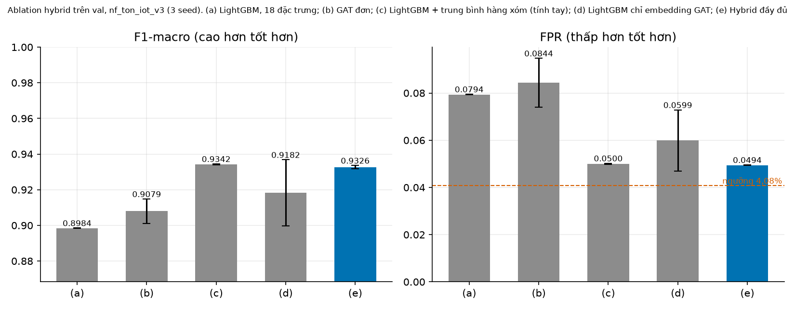

**Hình 5.10.** Ablation hybrid trên NF-ToN-IoT-v3. *Nguồn: `reports/figures/gd5_ablation_hybrid_nf_ton_iot_v3.png` (BoT: `gd5_ablation_hybrid_nf_bot_iot_v3.png`).*

**Kết luận của ablation.**

1. **Thông tin hàng xóm có ích:** (c) và (e) cao hơn (a) và (b) rõ rệt ở ToN (hybrid so với LightGBM thuần: +0,034 F1-macro; test: 0,9472 so với 0,9199 ở argmax, 0,9677 so với 0,9601 ở ngưỡng).
2. **Embedding GAT không hơn đặc trưng hàng xóm tính tay:** (e) − (c) = −0,0016 ở ToN và +0,0022 ở BoT, đều trong sai số; đặc trưng hàng xóm tính tay (36 cột, không cần huấn luyện GNN) cho kết quả tương đương. Trên test, (c) cũng ngang hybrid chính ở argmax (0,9477 so với 0,9472).
3. (d) kém (e) ở ToN (−0,0144) và không ổn định giữa các seed (std 0,0186): embedding một mình không đủ.
4. Ở BoT, LightGBM thuần (a) đã cao nhất (0,9388); hybrid và (c) không thêm được gì, vì dữ liệu chỉ có 20 IP nguồn và 3 lớp, và vì kết quả bị chặn bởi cùng một giới hạn của dữ liệu (mục 5.8).

**Giải thích khả dĩ** (một phần chưa kiểm chứng): đồ thị rất nhỏ (trung vị 11 node mỗi cửa sổ ở ToN, 5 node ở BoT) và homophily cao (0,67 và 0,86) nên cấu trúc hàng xóm có thể được tái tạo đủ bằng một phép trung bình; GAT khó học thêm gì ngoài đó. Giải thích này nhất quán với số liệu nhưng nhóm chưa có thí nghiệm riêng để kiểm chứng.

**Ablation cấu hình GAT** (val, NF-ToN-IoT-v3, đổi một yếu tố mỗi lần, 3 seed):

**Bảng 5.8. Ablation GAT (F1-macro val; trong ngoặc là số tham số).**

| Yếu tố | Giá trị → F1-macro |
|---|---|
| Số head | 1: 0,8537 (1.397) · 2: 0,8973 (3.813) · **4 (chính): 0,9065 ± 0,0019 (11.717)** · 8: 0,9153 ± 0,0036 (39.813) |
| Số lớp | 1: 0,9042 (3.077) · **2 (chính): 0,9065** · 3: 0,9034 ± 0,0089 (20.357) |
| Độ rộng mỗi head | 8: 0,9015 (3.813) · **16 (chính): 0,9065** · 32: 0,9078 (39.813) · 64: 0,9074 (145.157, vượt 100K) |
| Đặc trưng cạnh | **có (chính): 0,9065 (11.717)** · không: 0,9076 ± 0,0067 (11.333) |
| Kích thước cửa sổ (giây) | 1: 0,9011 · 2: 0,8985 · **5 (chính): 0,9065** · 10: 0,8866 ± 0,0078 |

*Nguồn: `reports/kaggle/gnn-iot-ids-16c-aggregate/ablation_gat.csv`, `ablation_gat_conclusion.json`; hình `gd5_ablation_gat_{heads,layers,hidden,edge,window}.png` cùng thư mục.*

Cấu hình chính hợp lý ở số lớp, độ rộng và cửa sổ (5 giây tốt nhất trong 4 mức). **Đặc trưng cạnh không được dữ liệu ủng hộ rõ rệt** (có hay không đều trong sai số). **Chưa tối ưu ở số head:** 8 head cao hơn 4 head 0,0089 (lớn hơn 2 lần std) với 39.813 tham số (vẫn ≤ 100K); nhóm không đổi cấu hình chính vì hybrid và mọi kết quả khác đã dựng trên nó (điểm đã nêu ở `freeze_list.md` mục 4).

### 5.4 Đánh đổi giữa độ chính xác và độ nhẹ (Pareto)

**Bảng 5.9. Hybrid chính và hybrid nhẹ trên NF-ToN-IoT-v3.**

| | Hybrid chính (5 GAT + LGBM n = 300, 63 lá) | Hybrid nhẹ (2 GAT + LGBM n = 100, 15 lá) | Nhỏ nhất đạt ngưỡng (1 GAT + LGBM n = 25, 7 lá) |
|---|---|---|---|
| Tham số / kích thước | 144.715 / 9,77 MB | **30.934 / 986 KB** | 12.592 / 172 KB |
| F1-macro val | 0,9326 ± 0,0009 | 0,9181 ± 0,0035 (−1,45 điểm %) | 0,9002 ± 0,0024 (−3,24 điểm %) |
| FPR val | 4,94% | 6,68% (+1,73 điểm %) | 8,30% (+3,36 điểm %) |
| p95 val (ms) | 27,6 | 6,9 | 4,4 |
| F1-macro test (argmax / ngưỡng) | 0,9472 / 0,9677 | 0,9341 / 0,9588 | không chạy test |
| FPR test (argmax / ngưỡng) | 4,20% / 1,88% | 5,69% / 2,27% | |
| Recall test (argmax / ngưỡng) | 97,65% / 96,71% | 97,83% / 95,65% | |

*Nguồn: `reports/kaggle/gnn-iot-ids-16c-aggregate/light_choice_nf_ton_iot_v3.json`, `pareto_hybrid_nf_ton_iot_v3.csv` (val); `reports/tables/summary_test.csv` (test). Có 37/50 điểm Pareto đạt cả ≤ 100.000 tham số và ≤ 1 MB.*

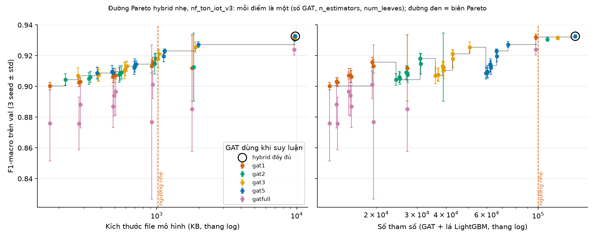

**Hình 5.11.** Đường Pareto F1-macro theo kích thước hybrid trên NF-ToN-IoT-v3. *Nguồn: `reports/figures/gd5_pareto_nf_ton_iot_v3.png`.*

Hybrid nhẹ giảm 1,3 điểm % F1-macro test ở argmax và 0,9 điểm % ở ngưỡng, FPR tăng 0,4–1,5 điểm %, nhưng nhỏ hơn khoảng 4,7 lần về tham số, nhỏ hơn khoảng 10 lần về kích thước file và nhanh khoảng 3,3 lần trên test (4,0 lần trên val). Một phát hiện phụ: ở ToN, dùng một GAT huấn luyện trên toàn bộ train (`gatfull`) tệ hơn một GAT nhóm 0,8–3,6 điểm % và không ổn định giữa seed (vì LightGBM học trên embedding OOF của các GAT khác); nên không dùng `gatfull` ở ToN. Trên BoT, hybrid chính (62.435 tham số, 777 KB) đã đạt ngưỡng nhẹ; bản nhỏ nhất 12.112 tham số, 126 KB có F1-macro val 0,9286 (−0,71 điểm %), FPR +2,17 điểm %.

### 5.5 Báo cáo theo tầng node

FPR cao ở ToN tập trung vào node chỉ nhận flow, nên kết quả được tách theo hai tầng: node có khởi tạo flow (62.170 node) và node chỉ nhận (59.600 node).

**Bảng 5.10. FPR và recall tấn công theo tầng, test, argmax.**

| Bộ | Mô hình | FPR: toàn bộ / khởi tạo / chỉ nhận | Recall tấn công: khởi tạo / chỉ nhận |
|---|---|---|---|
| NF-ToN-IoT-v3 | Hybrid chính | 4,20% / **1,03%** / 8,15% | 97,71% / 97,61% |
| | (c) | 4,61% / 1,52% / 8,47% | 98,36% / 98,27% |
| | LightGBM | 7,36% / 1,75% / 14,35% | 98,16% / 98,31% |
| | GAT | 8,17% / 4,17% / 13,16% | 98,55% / 99,18% |
| NF-BoT-IoT-v3 | Hybrid chính | 17,97% / 25,17% / 6,99% | 96,44% / 89,16% |
| | LightGBM | 18,10% / 25,09% / 7,44% | 97,08% / 95,81% |

*Nguồn: `reports/tables/summary_test_tiers.csv`; hình `gd6_tiers_<bộ>.png`.*

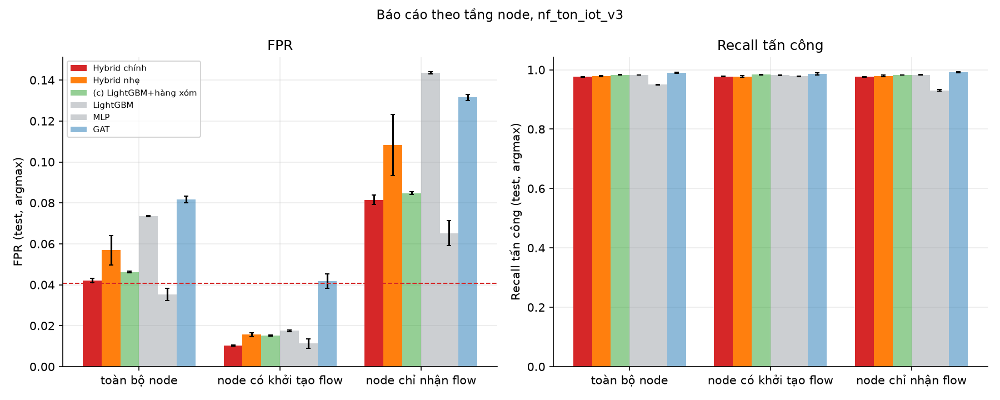

**Hình 5.12.** FPR và recall tấn công theo tầng node, NF-ToN-IoT-v3. *Nguồn: `reports/figures/gd6_tiers_nf_ton_iot_v3.png`.*

Ở ToN, FPR của hybrid chính chỉ **1,03% với node có khởi tạo flow**, còn điểm yếu nằm ở node chỉ nhận (8,15%); recall tấn công gần như như nhau giữa hai tầng. Ở BoT hình ảnh ngược lại: FPR cao ở node có khởi tạo (khoảng 25%) và thấp ở node chỉ nhận (khoảng 7%).

**Về việc không đổi cách gán nhãn.** Phân tích FPR (notebook `15a`) chỉ ra 92,5% (LightGBM) / 80,2% (GAT) node FP của ToN trên val là node chỉ nhận flow. Nếu chỉ gán nhãn node có khởi tạo flow, FPR phản thực tế của dự đoán sẵn có giảm từ 7,92% xuống 1,10%, nhưng thí nghiệm huấn luyện lại (notebook `15h`) cho thấy: FPR trên cùng tập con chỉ đổi 1,10% → 1,01%, tức mô hình cũ đã phân loại tốt node có khởi tạo; mức giảm FPR chỉ do **thu hẹp phạm vi đánh giá** (bỏ 59.273/121.599 node val, trong đó 18.853 trong 33.138 node tấn công, tức 57%, các node nạn nhân). Trên BoT, đổi nhãn còn làm FPR xấu đi (19,67% → 27,0% trên tập con). Vì vậy nhóm **không đổi cách gán nhãn** và báo cáo thêm theo tầng như trên. *(Nguồn: `reports/kaggle/gnn-iot-ids-15a-fpr-analysis/fpr_analysis_<bộ>.json`; `gnn-iot-ids-15h-label-pilot/`; TASKS 5.3.)*

### 5.6 Thử chéo giữa hai bộ dữ liệu

Huấn luyện trên bộ A, đánh giá trên tập test của bộ B, chỉ tính các lớp chung (Normal, DoS_DDoS, Truy_cap_trai_phep): các node B thuộc lớp khác bị bỏ, và khi dự đoán chỉ xét các cột lớp chung. Vì scaler fit riêng từng bộ, đặc trưng node của bộ B được đổi về không gian chuẩn hóa của bộ A.

**Bảng 5.11. Thử chéo (test, argmax; F1-macro 3 lớp chung / FPR / recall tấn công).**

| Chiều | Hybrid chính | GAT | LightGBM | (c) | Cùng bộ (hybrid, argmax) |
|---|---|---|---|---|---|
| ToN → BoT | 0,175 / 0,14% / 12,8% | 0,258 / 3,1% / 28,2% | 0,221 / 6,7% / 20,9% | 0,197 / 1,5% / 13,2% | BoT: 0,916 |
| BoT → ToN | 0,377 / 29,8% / 77,6% | 0,363 / 28,5% / 67,7% | 0,371 / 16,9% / 62,4% | 0,362 / 18,0% / 61,0% | ToN: 0,947 |

*Nguồn: `reports/tables/summary_test.csv` (các dòng `dataset` = `nf_ton_iot_v3→nf_bot_iot_v3` và `nf_bot_iot_v3→nf_ton_iot_v3`); hình `gd6_cross_dataset.png`. Cột "Cùng bộ" lấy từ Bảng 5.1 và 5.2 (F1-macro trên 4 lớp chính của ToN, 3 lớp của BoT, nên chỉ để tham khảo).*

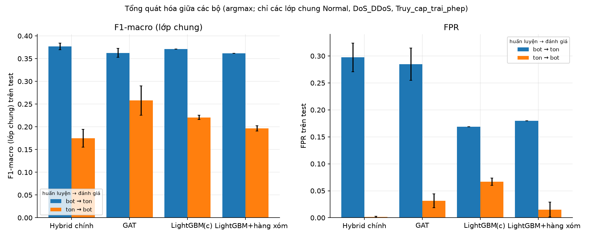

**Hình 5.13.** Thử chéo giữa hai bộ. *Nguồn: `reports/figures/gd6_cross_dataset.png`.*

**Mọi mô hình tổng quát hóa kém giữa hai bộ** (F1-macro 0,15–0,38 so với 0,89–0,95 khi cùng bộ); hybrid không tốt hơn (ToN → BoT hybrid thấp nhất; BoT → ToN cao nhất nhưng chỉ nhỉnh 0,006–0,015, trong sai số đo). Nguyên nhân hợp lý: hai bộ khác nhau về hạ tầng, loại tấn công và phân bố đặc trưng; BoT chỉ có 20 IP nguồn. Nhóm không tinh chỉnh gì theo kết quả này. Hệ quả: mô hình học trên một bộ **không nên** được triển khai trên mạng khác mà không huấn luyện lại hoặc thích nghi.

### 5.7 Phân tích lỗi

Phân tích trên hybrid chính, seed 42, tập test; mỗi nhóm lỗi có ví dụ cụ thể (IP, cửa sổ, nhãn, dự đoán, điểm) trong file nguồn.

**Bảng 5.12. Các nhóm lỗi của hybrid chính (argmax, seed 42).**

| Bộ | Nhóm lỗi | Số node | Tỉ lệ trong lỗi | Nhận xét và ví dụ |
|---|---|---|---|---|
| ToN (4.565 sai / 121.770 = 3,7%) | FP trên node chỉ nhận flow | 3.204 | 70,2% | Node nạn nhân hoặc máy chủ nhận flow từ nguồn tấn công; IP gặp nhiều: 192.168.1.193 (928), 192.168.1.152 (493), 52.59.177.21 (442). Ví dụ: 192.168.1.33, cửa sổ 311286993, Normal → Botnet_Backdoor, điểm 1,00 |
| | FN: tấn công bị đoán là Normal | 833 | 18,2% | Chủ yếu lớp Khac (626 node → Normal), thêm 97 Botnet_Backdoor, 71 DoS_DDoS, 39 Truy_cap_trai_phep; đặc trưng cấp node giống Normal |
| | FP trên node có khởi tạo flow | 486 | 10,6% | Mẫu lưu lượng giống tấn công (nhiều đích, nhiều flow); IP 192.168.1.33 (234), .31 (81), .36 (57) |
| | Nhầm giữa các lớp tấn công | 42 | 0,9% | Đúng là tấn công nhưng sai loại, như Khac → Truy_cap_trai_phep |
| BoT (922 sai / 10.665 = 8,6%) | FP trên node có khởi tạo flow | 425 | 46,1% | IP máy tấn công cũng sinh flow Normal: 192.168.100.150 (96), .147 (95), .148 (95) |
| | FN | 396 | 43,0% | Truy_cap_trai_phep → Normal; IP .149 (105), .3 (99), .150 (79); ít flow, ít đích |
| | FP trên node chỉ nhận flow | 76 | 8,2% | Chủ yếu 192.168.100.3 (72) |
| | Nhầm giữa các lớp tấn công | 25 | 2,7% | Truy_cap_trai_phep → DoS_DDoS |

*Nguồn: `reports/kaggle/gnn-iot-ids-18-aggregate/error_analysis.json` (mô hình `hybrid_gat_lgbm_oofavg_il`, seed 42). Ma trận nhầm lẫn ToN: 3.560 node Normal bị đoán Truy_cap_trai_phep; Botnet_Backdoor đúng 4.916/5.013; lớp Khac đúng 0/666 (không tính vào F1-macro theo D5).*

Điểm đáng chú ý: (1) hơn 70% lỗi ToN là cảnh báo giả ở node chỉ nhận flow, hợp với kết quả theo tầng; (2) lớp Khac (mitm, ransomware; 666 node test) **không được nhận ra** (0/666), nhưng lớp này không tính vào F1-macro nên không ảnh hưởng chỉ tiêu; (3) lớp Botnet_Backdoor có recall cao (98,1%) dù homophily của lớp này thấp nhất (0,476).

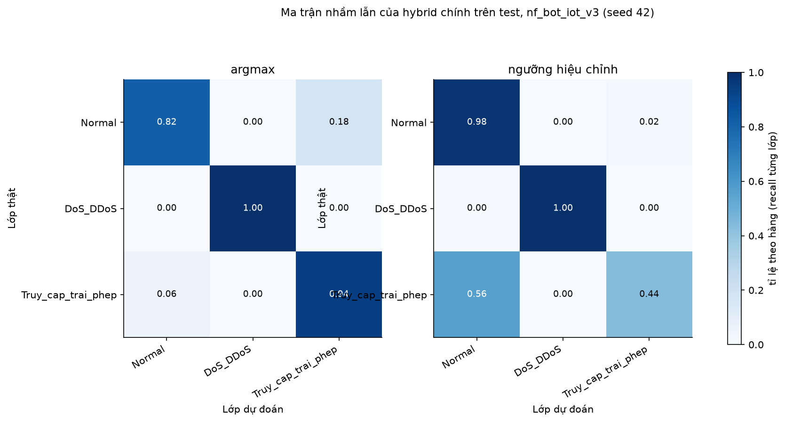

**Hình 5.14.** Ma trận nhầm lẫn của hybrid chính trên NF-BoT-IoT-v3. *Nguồn: `reports/figures/gd6_confusion_hybrid_nf_bot_iot_v3.png`.*

**Attention của GAT** (task 5.3, tiêu chí 4): trọng số attention của hai cửa sổ val mẫu được lưu và vẽ ở `gd6_attention_<bộ>.png`: cửa sổ 311226701 (15 node, mọi node DoS_DDoS, đoán đúng 15/15) và cửa sổ 311267371 (12 node, 10 Truy_cap_trai_phep và 2 Normal, đoán đúng 12/12). Đồ thị chỉ lưu nhãn nhóm nên chưa phân biệt dò quét với các tấn công khác trong cùng nhóm.

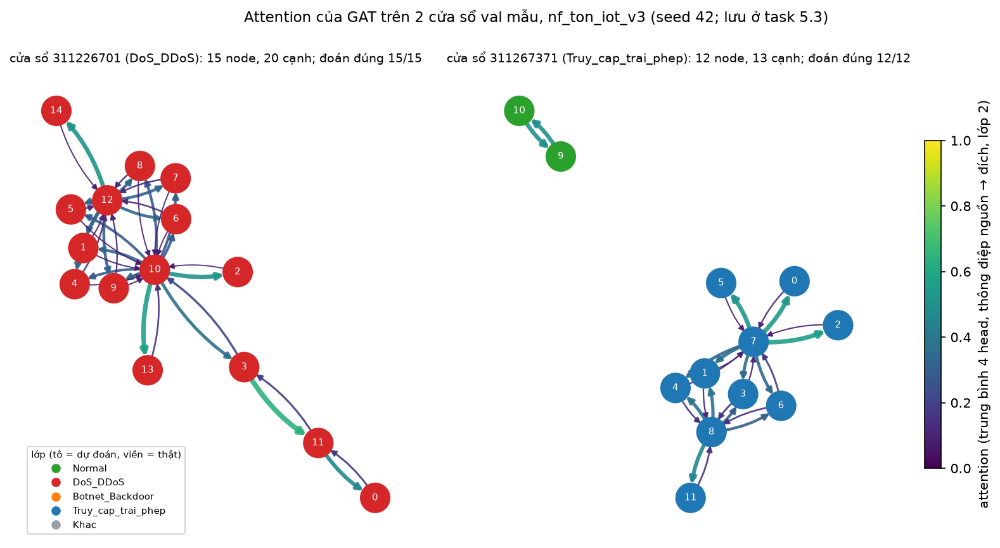

**Hình 5.15.** Attention của GAT trên hai cửa sổ mẫu. *Nguồn: `reports/figures/gd6_attention_nf_ton_iot_v3.png`.*

### 5.8 FPR khoảng 18% ở NF-BoT-IoT-v3 là do dữ liệu

Trên test BoT, FPR argmax của mọi mô hình nằm trong 17–24% (hybrid 17,97%, LightGBM 18,10%). Phân tích (notebook `15a`, trên val; LightGBM FPR 19,67%, GAT 20,84%) cho thấy:

1. FP dồn vào 7 IP trong 169 IP có node Normal; các IP 192.168.100.147–150 mỗi IP chiếm khoảng 20% số FP, với 62–66% node Normal của chính IP đó bị báo nhầm. **100% FP thuộc IP cũng là node tấn công ở cửa sổ khác** (chỉ 4,7% IP có node Normal thuộc loại này); toàn bộ train và val chỉ có 8 IP làm node tấn công trong 249 IP.
2. Nhãn rất thuần: 98,4% (LightGBM) / 96,5% (GAT) node FP có mọi flow đều Normal; không phải nhiễu nhãn.
3. 83–84% node FP có tâm lớp gần nhất là Truy_cap_trai_phep, trong khi 71% node Normal đoán đúng gần tâm Normal.
4. Mọi cách gán nhãn thay thế đều làm FPR **tệ hơn** (đa số mọi flow 21,3%; chỉ flow khởi tạo 26,8%; có ≥ 1 flow tấn công 21,2% với LightGBM).

Kết luận: các IP của máy tấn công cũng sinh flow Normal (Benign chỉ 0,3% số flow) có đặc trưng cấp node giống hệt lúc tấn công, nên bộ 18 đặc trưng không tách được; mọi mô hình kẹt cùng một mức. Hệ quả: ngưỡng 4,08% kéo recall xuống chỉ 47,5% (hybrid) trên test BoT. Cần nói rõ rằng đây là phân tích trên val; con số trên test (17,97%) khớp mức đó. *(Nguồn: `reports/kaggle/gnn-iot-ids-15a-fpr-analysis/fpr_analysis_nf_bot_iot_v3.json` và 4 hình `gd5_fpr_nf_bot_iot_v3_{ip,purity,centroid,relabel}.png` cùng thư mục.)*

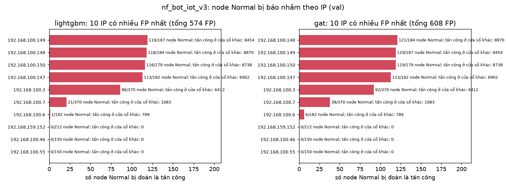

**Hình 5.16.** Phân bố FP theo IP trên NF-BoT-IoT-v3. *Nguồn: `reports/figures/gd5_fpr_nf_bot_iot_v3_ip.png`.*

### 5.9 Hiệu năng và độ trễ

Độ trễ trong Bảng 5.3 là phép đo **sơ bộ**: p95 của 200 lần chạy trên một cửa sổ trung vị, CPU Kaggle 1 luồng, gồm bước GAT và bước LightGBM. Hybrid chính ToN: 24,4 ms mỗi cửa sổ; hybrid nhẹ: 7,32 ms; BoT: 13,4 ms; tất cả ≪ 1 giây. Phép đo end-to-end (dựng đồ thị từ flow thô, ≥ 1.000 cửa sổ, tách thời gian từng bước, thông lượng flow mỗi giây, RAM tối đa) thuộc mô phỏng thời gian thực **[chờ GĐ I]**.

### 5.10 AHP: gợi ý mô hình triển khai **[chờ GĐ I]**

*(Cây phân cấp, ma trận so sánh cặp, CR, xếp hạng, phân tích độ nhạy và mô hình được gợi ý sẽ được điền sau khi GĐ I hoàn tất. Ghi chú đã chốt từ trước: bản gợi ý triển khai trên NF-ToN-IoT-v3 do AHP quyết định giữa hybrid chính, hybrid nhẹ và các mô hình nhẹ khác; xem ghi chú ở mục 5.12.)*

### 5.11 Mô phỏng thời gian thực **[chờ GĐ I]**

*(Đo end-to-end `stream_features.py` và `detector.py`: độ trễ p50/p95/p99, thông lượng, RAM, so khớp dự đoán online và offline, số cảnh báo giả mỗi giờ, thời gian phát hiện từng đợt tấn công, kèm `alerts_sample.csv`. Sẽ điền sau GĐ I.)*

### 5.12 Tổng hợp: đối chiếu với các nhận định chính

**Bảng 5.13. Sáu nhận định chính và bằng chứng.**

| # | Nhận định | Bằng chứng |
|---|---|---|
| 1 | Trên bộ chính, hybrid có F1-macro test cao nhất ở chế độ ngưỡng (0,9677); vượt ML, MLP và (c) ở chế độ ngưỡng; so với GraphSAGE chỉ nhỉnh hơn (+0,0078 < 2 std = 0,0083). Ở argmax, (c) nhỉnh hơn 0,0005 | Bảng 5.1, 5.4 |
| 2 | Trên NF-BoT-IoT-v3, LightGBM tốt hơn hybrid ở argmax (0,9291 so với 0,9164) | Bảng 5.2, 5.6 |
| 3 | Phần lớn lợi thế đến từ thông tin hàng xóm: (c) ngang hybrid trên val và test | Bảng 5.7, 5.1 |
| 4 | Chỉ tiêu "hybrid vượt mọi baseline" không đạt | Bảng 5.4, mục 6.1 |
| 5 | Hybrid nhẹ đạt mọi chỉ tiêu hiệu năng và độ nhẹ ở chế độ ngưỡng trên ToN (nhưng không có ưu thế so với GraphSAGE và GAT đơn — xem dưới) | Bảng 6.1, 6.2 |
| 6 | FPR ≈ 18% ở BoT do dữ liệu; thử chéo giữa hai bộ rất kém | Mục 5.8, 5.6 |

**Một đối chiếu bổ sung cho nhận định 5.** Ở chế độ ngưỡng, GraphSAGE (10.949 tham số, 46 KB) và GAT đơn (11.717 tham số, 50,6 KB) cũng đạt đồng thời accuracy ≥ 91%, FPR ≤ 4,08%, recall ≥ 95%, F1-macro ≥ 0,80, std accuracy ≤ 1,5 điểm %, ≤ 100.000 tham số, ≤ 1 MB và độ trễ ≤ 1 s trên ToN (Bảng 5.1, 5.3): GraphSAGE accuracy 96,80%, FPR 3,15%, recall 96,70%, std accuracy 0,66 điểm %; GAT accuracy 96,79%, FPR 2,53%, recall 95,20%, std 0,51 điểm %. F1-macro của hybrid nhẹ (0,9588) so với GraphSAGE (0,9600) chênh −0,0012 (Bảng 5.5) và so với GAT (0,9572) chênh +0,0016; cả hai đều nhỏ hơn 2 lần std lớn hơn (0,0083 và 0,0048; chênh sau do chúng tôi tính từ `summary_test.csv` theo quy ước ở mục 2.6, `conclusions.csv` không có hàng này), nên theo quy ước của báo cáo là "chưa đủ" để nói hybrid nhẹ hơn hoặc kém. Vì vậy "hybrid nhẹ đạt mọi chỉ tiêu" là đúng nhưng **không phải ưu thế riêng của hybrid**; hybrid nhẹ chỉ có lợi ở chỗ hybrid chính (mạnh nhất) có thể thu nhỏ với mức giảm F1-macro 0,9–1,3 điểm %. (Đối chiếu này do chúng tôi suy từ `summary_test.csv`; `targets.csv` chỉ tính cho hybrid.)

---

## Chương 6. Kết luận

### 6.1 Chỉ tiêu đạt và chưa đạt

Chỉ tiêu nghiệm thu được kiểm trên bộ chính NF-ToN-IoT-v3 (chính thức); các dòng của NF-BoT-IoT-v3 chỉ tham khảo.

**Bảng 6.1. Đối chiếu chỉ tiêu, NF-ToN-IoT-v3, test, 3 seed.**

| Chỉ tiêu (ngưỡng) | Hybrid chính, argmax | Hybrid chính, ngưỡng | Hybrid nhẹ, argmax | Hybrid nhẹ, ngưỡng |
|---|---|---|---|---|
| Accuracy ≥ 91% | 96,30% — đạt | 97,69% — đạt | 95,24% — đạt | 97,11% — đạt |
| FPR ≤ 4,08% | 4,20% — **không đạt** | 1,88% — đạt | 5,69% — **không đạt** | 2,27% — đạt |
| Recall tấn công ≥ 95% | 97,65% — đạt | 96,71% — đạt | 97,83% — đạt | 95,65% — đạt |
| F1-macro ≥ 0,80 | 0,9472 — đạt | 0,9677 — đạt | 0,9341 — đạt | 0,9588 — đạt |
| Std accuracy ≤ 1,5 điểm % | 0,06 — đạt | 0,04 — đạt | 0,51 — đạt | 0,07 — đạt |
| Tham số ≤ 100.000 | 144.518 — **không đạt** | 144.518 — **không đạt** | 30.934 — đạt | 30.934 — đạt |
| Kích thước ≤ 1 MB | 9.747 KB — **không đạt** | 9.747 KB — **không đạt** | 986 KB — đạt | 986 KB — đạt |
| Độ trễ p95 ≤ 1 s | 24,4 ms — đạt (sơ bộ) | đạt (sơ bộ) | 7,32 ms — đạt (sơ bộ) | đạt (sơ bộ) |
| Hybrid > baseline tốt nhất (F1 > 2 std và McNemar) | **Không đạt** (2/4 nhóm) | **Không đạt** (3/4 nhóm) | **Không đạt** (1/4) | **Không đạt** (1/4) |
| Số bộ dữ liệu ≥ 2 | Đạt (ToN và BoT đều có kết quả test) | | | |
| Tái lập lệch ≤ 0,5 điểm % | Sơ bộ đạt (F1 val dựng lại lệch 0,0); `21_reproduce` **chưa chạy** | | | |

*Nguồn: `reports/tables/targets.csv`, `summary_test.csv`.*

**Kết luận về chỉ tiêu.**

- **Đạt:** accuracy, recall tấn công, F1-macro, độ ổn định, độ trễ (sơ bộ) và số bộ dữ liệu. FPR đạt ở chế độ ngưỡng (hybrid chính 1,88%, hybrid nhẹ 2,27%) nhưng **không đạt ở argmax** (4,20% và 5,69%).
- **Hybrid nhẹ đạt mọi chỉ tiêu hiệu năng và độ nhẹ ở chế độ ngưỡng** (accuracy 97,11%, FPR 2,27%, recall 95,65%, F1-macro 0,9588, 30.934 tham số, 986 KB, 7,32 ms); GraphSAGE và GAT đơn cũng đạt (mục 5.12).
- **Hybrid chính không đạt tham số và kích thước** (144.518 tham số, 9,75 MB), do 5 GAT nhóm và file LightGBM.
- **Không đạt: "hybrid vượt mọi baseline".** Hybrid vượt ML, MLP, GNN đơn ở từng chế độ nhưng không vượt cả bốn nhóm cùng lúc, và phương án (c) cho kết quả tương đương. Đây là kết quả trung thực của đề tài.
- **Bộ thứ hai (tham khảo):** ở argmax hybrid đạt accuracy 91,20% và F1-macro 0,9164, nhưng FPR 17,97% và recall 94,79% (chưa tới 95%); ở ngưỡng FPR 1,19% nhưng recall chỉ 47,47% và F1-macro 0,7084 (không đạt 0,80), std accuracy 1,69 điểm % (không đạt 1,5).
- **Chưa kiểm tra:** AHP, thời gian thực, độ trễ end-to-end và tái lập đầy đủ **[chờ GĐ I và GĐ J]**.

**Về minh chứng "hybrid cao hơn baseline" mà thầy yêu cầu.** Kết quả có hai mặt. Hybrid là mô hình có F1-macro cao nhất trên bộ chính ở chế độ ngưỡng và vượt có ý nghĩa baseline ML tốt nhất; nhưng nó không vượt có ý nghĩa mọi baseline, không cao nhất trên bộ thứ hai ở argmax, và phần lớn lợi thế của nó đến từ thông tin hàng xóm, có thể đạt tương đương bằng một phép trung bình đơn giản. Nhóm không khẳng định embedding GAT tốt hơn tổng hợp tay.

### 6.2 Hạn chế

1. **Hybrid không vượt rõ (c).** Giả thuyết ban đầu "embedding GAT học được có ích hơn tổng hợp thủ công" không được số liệu ủng hộ (mục 5.3).
2. **Cách chia tập.** `blocked` đo khả năng tổng quát hóa sang các khối thời gian xen kẽ, không phải dự đoán tương lai; ranh giới giữa các tập chỉ cách 1 cửa sổ; val và test là các khối khác nhau nên điểm hai tập không so trực tiếp (ví dụ recall hybrid ToN dưới 95% ở val nhưng trên 95% ở test).
3. **NF-BoT-IoT-v3 hạn chế.** 20 IP nguồn, Normal 0,3% flow, không có Botnet_Backdoor và Khac; FPR ≈ 18% do dữ liệu; ngưỡng 4,08% kéo recall xuống 47,5%. Kết luận về hybrid nên dựa trên bộ chính.
4. **Ý nghĩa thống kê.** Các node cùng cửa sổ không độc lập nên p-value McNemar nhỏ quá mức; nhóm chỉ đọc là "có khác biệt". Chỉ có 3 seed; std của một số baseline xác định bằng 0 nên tiêu chí 2 lần std chủ yếu phụ thuộc vào std của hybrid.
5. **Tìm kiếm tham số hẹp.** Baseline chỉ thử 3 (hoặc 2) cấu hình mỗi mô hình, hybrid dùng cùng lưới 3 cấu hình LightGBM; baseline có thể chưa được tối ưu hết.
6. **Kích thước hybrid chính.** 144.518 tham số và 9,75 MB, phần lớn là LightGBM; đã giải quyết bằng hybrid nhẹ với giảm F1-macro 0,9–1,3 điểm %.
7. **Nhãn và lớp.** Nhóm Truy_cap_trai_phep gộp dò quét, XSS, mật khẩu, tiêm mã; đồ thị chỉ lưu nhãn nhóm. Lớp Khac (mitm, ransomware) không được nhận ra (0/666 node test).
8. **FPR ở node chỉ nhận.** FPR của ToN tập trung ở node nạn nhân (8,15% so với 1,03% ở node khởi tạo); nhãn node chỉ nhận lấy từ flow nhận nên đặc trưng 18 chiều khó tách.
9. **Độ trễ chưa end-to-end.** Chỉ đo sơ bộ (200 lần trên 1 cửa sổ, CPU Kaggle 1 luồng), chưa gồm dựng đồ thị và chưa ≥ 1.000 cửa sổ **[chờ GĐ I]**.
10. **Chưa so sánh với nghiên cứu khác.** Nhóm chưa làm bảng so sánh (task 6.4) nên báo cáo không đưa ra khẳng định "tốt hơn công trình khác"; các công trình khác phân loại ở mức flow nên không so trực tiếp.
11. **Tổng quát hóa giữa các bộ.** Rất kém (F1-macro 0,15–0,38); mô hình cần huấn luyện lại cho từng mạng.
12. **Giờ GPU chưa đầy đủ.** Tài khoản Kaggle dùng chung với dự án khác; giờ GPU của notebook `07` không được ghi.
13. **Chưa chạy kiểm tra tái lập** (`21_reproduce`).

### 6.3 Hướng phát triển

1. **Phân loại mức flow** (như E-GraphSAGE [21]) hoặc kết hợp node và flow để khắc phục việc node chỉ nhận bị gán nhãn từ flow nhận.
2. **Đặc trưng giàu hơn:** lịch sử nhiều cửa sổ (embedding cửa sổ trước), đặc trưng theo cổng và theo dịch vụ, phân biệt dò quét với các tấn công khác trong nhóm Truy_cap_trai_phep.
3. **Đồ thị thời gian:** GNN theo dõi diễn biến liên cửa sổ (GAT + GRU, phương án B đã cân nhắc ở D9).
4. **Ngưỡng theo tầng và hiệu chỉnh xác suất:** ngưỡng riêng cho node khởi tạo và node chỉ nhận; hiệu chỉnh xác suất thay vì chỉ chọn ngưỡng.
5. **Thích nghi miền** giữa các mạng để khắc phục tổng quát hóa kém; thêm bộ dữ liệu có nhiều IP hơn.
6. **Làm nhẹ hơn:** lượng tử hóa, pruning, thay LightGBM bằng cây nhỏ hơn; thử 8 head (ablation cho thấy cao hơn 0,0089).
7. **Hoàn thiện triển khai:** AHP chốt mô hình, đo end-to-end trên gateway thật hoặc Docker giới hạn tài nguyên **[chờ GĐ I]**.

---

## Phụ lục A. Đối chiếu 5 yêu cầu của thầy ngày 12/11/2026

**Bảng A.1.**

| # | Thầy yêu cầu | Nhóm đáp ứng | Mục trong báo cáo | Mức đáp ứng |
|---|---|---|---|---|
| 1 | NF-ToN, chọn ít nhất 2 bộ dữ liệu | NF-ToN-IoT-v3 (chính) + NF-BoT-IoT-v3; khảo sát 8 bộ | 3.1, 3.2; Bảng 5.1, 5.2 | Đạt |
| 2 | Mô hình hybrid, lý do chọn | Hybrid GAT + LightGBM; lý do và đối chiếu với số liệu | 2.5, 4.4, 5.3 | Đạt; lý do được kiểm chứng **một phần** (thông tin hàng xóm có ích, embedding GAT không hơn đặc trưng hàng xóm tính tay) |
| 3 | Kaggle, 30 giờ, T4 | Mọi huấn luyện trên Kaggle; Tesla T4; ≈ 4,09 giờ GPU | 4.9; Bảng 4.5; Phụ lục C | Đạt |
| 4 | Xử lý EDA | EDA mức flow và mức đồ thị cho cả 2 bộ: 26 hình, homophily, cửa sổ mẫu | 3.3–3.5 | Đạt (thiếu hình riêng cho giao thức và cổng) |
| 5 | Minh chứng hybrid cao hơn baseline (ML, DL, …) | Cùng cách chia, 3 seed, McNemar, ablation, 5 baseline + 3 GNN đơn + (c) | 5.1–5.4; 6.1 | **Đạt một phần:** hybrid vượt ML tốt nhất, nhưng không vượt mọi baseline (chỉ tiêu không đạt) |

Các hạng mục khác của đề tài chưa có trong 5 yêu cầu: AHP (mục 5.10) và mô phỏng thời gian thực (mục 5.11) **[chờ GĐ I]**.

## Phụ lục B. Nguồn số liệu và cách truy vết

| Nội dung | File nguồn |
|---|---|
| Bảng test, hai chế độ | `reports/tables/summary_test.csv`; dòng chi tiết từng seed: `reports/tables/results.csv` (cột `commit` = `abcb5f8` = tag `freeze-v1`) |
| Theo tầng node | `reports/tables/summary_test_tiers.csv` |
| McNemar | `reports/tables/mcnemar.csv` (162 dòng); kết luận: `reports/tables/conclusions.csv` |
| Chỉ tiêu nghiệm thu | `reports/tables/targets.csv` |
| Val | `reports/tables/summary_val.csv`; `reports/kaggle/gnn-iot-ids-15c-compare-check/compare_val_<bộ>.csv` |
| Ablation, Pareto, ngưỡng, bản cải tiến | `reports/kaggle/gnn-iot-ids-16c-aggregate/` |
| Phân tích FPR, đổi nhãn | `reports/kaggle/gnn-iot-ids-15a-fpr-analysis/`, `gnn-iot-ids-15h-label-pilot/` |
| Phân tích lỗi | `reports/kaggle/gnn-iot-ids-18-aggregate/error_analysis.json` |
| Dữ liệu và đồ thị | `docs/dataset_cards/`, `reports/tables/graphs_v2/`, `reports/tables/split_search/` |
| EDA | `reports/figures/gd2_*`, `reports/kaggle/gnn-iot-ids-12-eda/` |
| Giờ GPU, RAM | `reports/kaggle/*/run_info.json` |
| Quyết định D1–D13, chỉ tiêu | `docs/gnn_ids/KE_HOACH.md` mục 3, 7 |
| Nhật ký chi tiết, đóng băng | `docs/gnn_ids/TASKS.md`, `docs/gnn_ids/freeze_list.md` |

**Ghi chú về nguồn số liệu.**

1. Các hình `gd5_*` (ablation, Pareto, phân tích FPR) nằm trong thư mục kết quả của từng notebook ở `reports/kaggle/`, không nằm trong `reports/figures/`.
2. Một số baseline ToN trong `compare_val` do notebook `15` sinh dùng file kết quả mà Kaggle mount từ notebook `05`, nội dung khác bản trong repo (ví dụ LightGBM val 0,9351 so với 0,8984); bản repo khớp log `baseline_search` nên báo cáo dùng bản repo (đã kiểm ở notebook `15c`). Nguyên nhân bản mount khác chưa rõ.
3. Dòng phân tích lỗi trong `TASKS.md` mục 6.3 (6.883 node sai ToN = 5,7%; 698 node sai BoT = 6,6%) khác file `error_analysis.json` (4.565 = 3,7% và 922 = 8,6%). Báo cáo dùng file JSON vì tỉ lệ lỗi của nó khớp accuracy test của hybrid chính (96,30% và 91,20%), còn số trong `TASKS.md` thì không.

## Phụ lục C. Các notebook Kaggle và giờ GPU

Bảng liệt kê các notebook chính (bỏ `15c`, `15t` và các lần chạy hỏng, mỗi cái chạy vài giây hoặc không có `run_info.json`).

| Giai đoạn | Notebook | Thiết bị | Thời gian (s) | RAM đỉnh (GB) | Commit |
|---|---|---|---|---|---|
| B | `11-build-graphs-bot` | CPU | 726 | 12,25 | `47dccee` |
| C | `12-eda` | CPU | 575 | 4,23 | `d2e4d1a` |
| D | `13-baselines` | CPU | 293 | 0,85 | `93c6625` |
| E | `14-train-gnn-bot` | CPU | 425 | 0,66 | `ac05c06` |
| F | `15-hybrid` | **GPU T4** | 3.427 | 2,78 | `603d929` |
| F | `15a-fpr-analysis` | CPU | 656 | 19,61 | `e1cc0fb` |
| F | `15b-hybrid-oofavg` | **GPU T4** | 2.974 | 3,36 | `f63efc1` |
| F | `15d-hybrid-stack` | CPU | 849 | 1,56 | `2d2187d` |
| F | `15e-hybrid-il` | CPU | 669 | 0,76 | `e91a3dd` |
| F | `15f-hybrid-il-ton` | **GPU T4** | 2.494 | 3,39 | `8f13f79` |
| F | `15h-label-pilot` | CPU | 267 | 1,24 | `2c600be` |
| G | `16-ablation` (bản 3) | **GPU T4** | 3.841 | 2,02 | `5031ab5` |
| G | `16f-windows-gat` | **GPU T4** | 1.713 | 3,65 | `5169a1d` |
| G | `16a`, `16b`, `16c`, `16d`, `16e`, `16g`, `16t` | CPU | 101–7.244 | ≤ 18,79 | `ad92f6a` và khác |
| H | `16h-c-threshold` | CPU | 503 | 1,36 | `e5ee654` |
| H | `17a-dryrun-val` | CPU | 2.450 | 2,5 | `9cae412` |
| H | `17-final-test` | CPU | 2.668 | 2,6 | `abcb5f8` (tag `freeze-v1`) |
| H | `18-aggregate` | CPU | 269 | 0,69 | `da0f05f` |

*Nguồn: `reports/kaggle/<notebook>/run_info.json`. Tổng thời gian các notebook có `run_info.json`: khoảng 11,66 giờ, trong đó 4,01 giờ GPU. Các notebook GĐ A (`05`, `07`, `09`, `10`) không có `run_info.json`.*

---

## Tài liệu tham khảo

Chuẩn trích dẫn: tác giả, năm, nhan đề, nơi đăng, DOI hoặc arXiv. Cột "Kiểm chứng" cho biết đã tra cứu những gì: **Crossref** = DOI đã tra và tiêu đề, tác giả, trang, năm khớp; **arXiv** = mã arXiv đã tra, tiêu đề, tác giả và năm khớp nhưng **nơi đăng chưa tra** (đánh dấu **[cần kiểm tra]**). Tổng cộng 44 tài liệu, trong đó 12 tài liệu từ năm 2022 trở lại (các mục 3, 4, 7, 8, 9, 17, 20, 21, 22, 28, 29, 39).

| # | Tài liệu | DOI / arXiv | Kiểm chứng |
|---|---|---|---|
| 1 | Sommer, R., Paxson, V. (2010). Outside the closed world: On using machine learning for network intrusion detection. *IEEE Symposium on Security and Privacy*, 305–316 | 10.1109/SP.2010.25 | Crossref |
| 2 | Axelsson, S. (2000). The base-rate fallacy and the difficulty of intrusion detection. *ACM TISSEC* 3(3), 186–205 | 10.1145/357830.357849 | Crossref |
| 3 | Bilot, T., El Madhoun, N., Al Agha, K., Zouaoui, A. (2023). Graph neural networks for intrusion detection: A survey. *IEEE Access* 11, 49114–49139 | 10.1109/ACCESS.2023.3275789 | Crossref |
| 4 | Zhong, M., Lin, M., Zhang, C., Xu, Z. (2024). A survey on graph neural networks for intrusion detection systems: Methods, trends and challenges. *Computers & Security* 141, 103821 | 10.1016/j.cose.2024.103821 | Crossref |
| 5 | Claise, B. (2004). Cisco Systems NetFlow Services Export Version 9. RFC 3954 | 10.17487/RFC3954 | Crossref (chỉ khớp nhan đề; **[cần kiểm tra]** tên tác giả) |
| 6 | Claise, B., Trammell, B., Aitken, P. (2013). Specification of the IP Flow Information Export (IPFIX) Protocol. RFC 7011 | 10.17487/RFC7011 | Crossref (khớp nhan đề và một tác giả; **[cần kiểm tra]** danh sách tác giả đầy đủ) |
| 7 | Sarhan, M., Layeghy, S., Portmann, M. (2022). Towards a standard feature set for network intrusion detection system datasets. *Mobile Networks and Applications* 27(1), 357–370 | 10.1007/s11036-021-01843-0; arXiv:2101.11315 | Crossref |
| 8 | Luay, M., Layeghy, S., Noorbin, N., Sarhan, M., Kulatilleke, G., Moustafa, N., Portmann, M. (2026). Time matters: Temporal NetFlow features for ML-based network intrusion detection. *IEEE Access* 14, 66899–66913. (Bản preprint: arXiv:2503.04404, "Temporal analysis of NetFlow datasets for network intrusion detection systems", 2025) | 10.1109/ACCESS.2026.3688204 | Crossref; arXiv |
| 9 | Luay, M., Layeghy, S., Sarhan, M., Hoseininoorbin, S., Moustafa, N., Portmann, M. (2025). NF-ToN-IoT-v3 [bộ dữ liệu]. The University of Queensland | 10.48610/44d7c5e | **[cần kiểm tra]**: DOI của UQ eSpace, không tra được qua Crossref; thông tin lấy từ phiếu dataset (task 1.2) |
| 10 | Moustafa, N. (2021). A new distributed architecture for evaluating AI-based security systems at the edge: Network TON_IoT datasets. *Sustainable Cities and Society* 72, 102994 | 10.1016/j.scs.2021.102994 | Crossref |
| 11 | Alsaedi, A., Moustafa, N., Tari, Z., Mahmood, A., Anwar, A. (2020). TON_IoT telemetry dataset: A new generation dataset of IoT and IIoT for data-driven intrusion detection systems. *IEEE Access* 8, 165130–165150 | 10.1109/ACCESS.2020.3022862 | Crossref |
| 12 | Koroniotis, N., Moustafa, N., Sitnikova, E., Turnbull, B. (2019). Towards the development of realistic botnet dataset in the Internet of Things for network forensic analytics: Bot-IoT dataset. *Future Generation Computer Systems* 100, 779–796 | 10.1016/j.future.2019.05.041 | Crossref |
| 13 | Gilmer, J., Schoenholz, S. S., Riley, P. F., Vinyals, O., Dahl, G. E. (2017). Neural message passing for quantum chemistry. *ICML 2017* | arXiv:1704.01212 | arXiv; **[cần kiểm tra]** nơi đăng |
| 14 | Kipf, T. N., Welling, M. (2017). Semi-supervised classification with graph convolutional networks. *ICLR 2017* | arXiv:1609.02907 | arXiv; **[cần kiểm tra]** nơi đăng |
| 15 | Hamilton, W. L., Ying, R., Leskovec, J. (2017). Inductive representation learning on large graphs. *NeurIPS 2017* | arXiv:1706.02216 | arXiv; **[cần kiểm tra]** nơi đăng |
| 16 | Veličković, P., Cucurull, G., Casanova, A., Romero, A., Liò, P., Bengio, Y. (2018). Graph attention networks. *ICLR 2018* | arXiv:1710.10903 | arXiv; **[cần kiểm tra]** nơi đăng |
| 17 | Brody, S., Alon, U., Yahav, E. (2022). How attentive are graph attention networks? *ICLR 2022* | arXiv:2105.14491 | arXiv; **[cần kiểm tra]** nơi đăng |
| 18 | Zhu, J., Yan, Y., Zhao, L., Heimann, M., Akoglu, L., Koutra, D. (2020). Beyond homophily in graph neural networks: Current limitations and effective designs. *NeurIPS 2020* | arXiv:2006.11468 | arXiv; **[cần kiểm tra]** nơi đăng |
| 19 | Lim, D., Hohne, F., Li, X., Huang, S. L., Gupta, V., Bhalerao, O., Lim, S. N. (2021). Large scale learning on non-homophilous graphs: New benchmarks and strong simple methods. *NeurIPS 2021* | arXiv:2110.14446 | arXiv; **[cần kiểm tra]** nơi đăng |
| 20 | Platonov, O., Kuznedelev, D., Babenko, A., Prokhorenkova, L. (2023). Characterizing graph datasets for node classification: Homophily-heterophily dichotomy and beyond. *NeurIPS 2023* (arXiv 2022) | arXiv:2209.06177 | arXiv; **[cần kiểm tra]** nơi đăng |
| 21 | Lo, W. W., Layeghy, S., Sarhan, M., Gallagher, M., Portmann, M. (2022). E-GraphSAGE: A graph neural network based intrusion detection system for IoT. *IEEE/IFIP NOMS 2022* | 10.1109/NOMS54207.2022.9789878; arXiv:2103.16329 | Crossref |
| 22 | Caville, E., Lo, W. W., Layeghy, S., Portmann, M. (2022). Anomal-E: A self-supervised network intrusion detection system based on graph neural networks. *Knowledge-Based Systems* 258, 110030 | 10.1016/j.knosys.2022.110030; arXiv:2207.06819 | Crossref |
| 23 | Zhou, J., Cui, G., Hu, S., Zhang, Z., Yang, C., Liu, Z., … Sun, M. (2020). Graph neural networks: A review of methods and applications. *AI Open* 1, 57–81 | 10.1016/j.aiopen.2021.01.001 | Crossref |
| 24 | Wu, Z., Pan, S., Chen, F., Long, G., Zhang, C., Yu, P. S. (2021). A comprehensive survey on graph neural networks. *IEEE TNNLS* 32(1), 4–24 | 10.1109/TNNLS.2020.2978386 | Crossref |
| 25 | Breiman, L. (2001). Random forests. *Machine Learning* 45(1), 5–32 | 10.1023/A:1010933404324 | Crossref |
| 26 | Chen, T., Guestrin, C. (2016). XGBoost: A scalable tree boosting system. *KDD 2016*, 785–794 | 10.1145/2939672.2939785 | Crossref |
| 27 | Ke, G., Meng, Q., Finley, T., Wang, T., Chen, W., Ma, W., Ye, Q., Liu, T.-Y. (2017). LightGBM: A highly efficient gradient boosting decision tree. *NeurIPS 2017* | không có DOI hoặc arXiv | **[cần kiểm tra]**: đã xác nhận trang của NeurIPS có bài này; danh sách tác giả và trang theo trí nhớ |
| 28 | Grinsztajn, L., Oyallon, E., Varoquaux, G. (2022). Why do tree-based models still outperform deep learning on typical tabular data? *NeurIPS 2022 Datasets and Benchmarks* | arXiv:2207.08815 | arXiv; **[cần kiểm tra]** nơi đăng |
| 29 | Shwartz-Ziv, R., Armon, A. (2022). Tabular data: Deep learning is not all you need. *Information Fusion* 81, 84–90 | 10.1016/j.inffus.2021.11.011; arXiv:2106.03253 | Crossref |
| 30 | Ivanov, S., Prokhorenkova, L. (2021). Boost then convolve: Gradient boosting meets graph neural networks. *ICLR 2021* | arXiv:2101.08543 | arXiv; **[cần kiểm tra]** nơi đăng |
| 31 | Wolpert, D. H. (1992). Stacked generalization. *Neural Networks* 5(2), 241–259 | 10.1016/S0893-6080(05)80023-1 | Crossref |
| 32 | Saaty, T. L. (1977). A scaling method for priorities in hierarchical structures. *Journal of Mathematical Psychology* 15(3), 234–281 | 10.1016/0022-2496(77)90033-5 | Crossref |
| 33 | Saaty, T. L. (2008). Decision making with the analytic hierarchy process. *International Journal of Services Sciences* 1(1), 83–98 | 10.1504/IJSSCI.2008.017590 | Crossref (khớp nhan đề, năm, trang đầu 83; **[cần kiểm tra]** trang cuối 98) |
| 34 | Saaty, T. L. (1980). *The Analytic Hierarchy Process*. McGraw-Hill | không có DOI | **[cần kiểm tra]**: sách, chưa tra nhà xuất bản và bảng RI trong bản gốc; các giá trị RI trong mục 2.7 lấy theo thông lệ AHP |
| 35 | McNemar, Q. (1947). Note on the sampling error of the difference between correlated proportions or percentages. *Psychometrika* 12(2), 153–157 | 10.1007/BF02295996 | Crossref |
| 36 | Dietterich, T. G. (1998). Approximate statistical tests for comparing supervised classification learning algorithms. *Neural Computation* 10(7), 1895–1923 | 10.1162/089976698300017197 | Crossref |
| 37 | Fawcett, T. (2006). An introduction to ROC analysis. *Pattern Recognition Letters* 27(8), 861–874 | 10.1016/j.patrec.2005.10.010 | Crossref |
| 38 | Davis, J., Goadrich, M. (2006). The relationship between precision-recall and ROC curves. *ICML 2006*, 233–240 | 10.1145/1143844.1143874 | Crossref |
| 39 | Arp, D., Quiring, E., Pendlebury, F., Warnecke, A., Pierazzi, F., Wressnegger, C., Cavallaro, L., Rieck, K. (2022). Dos and don'ts of machine learning in computer security. *USENIX Security 2022* | arXiv:2010.09470 | arXiv; **[cần kiểm tra]** nơi đăng |
| 40 | Engelen, G., Rimmer, V., Joosen, W. (2021). Troubleshooting an intrusion detection dataset: The CICIDS2017 case study. *IEEE Security and Privacy Workshops* | 10.1109/SPW53761.2021.00009 | Crossref |
| 41 | Lin, T.-Y., Goyal, P., Girshick, R., He, K., Dollár, P. (2017). Focal loss for dense object detection. *ICCV 2017*, 2999–3007 | 10.1109/ICCV.2017.324; arXiv:1708.02002 | Crossref |
| 42 | He, K., Zhang, X., Ren, S., Sun, J. (2016). Deep residual learning for image recognition. *CVPR 2016*, 770–778 | 10.1109/CVPR.2016.90 | Crossref |
| 43 | Ba, J. L., Kiros, J. R., Hinton, G. E. (2016). Layer normalization. arXiv preprint | arXiv:1607.06450 | arXiv |
| 44 | Kingma, D. P., Ba, J. (2015). Adam: A method for stochastic optimization. *ICLR 2015* | arXiv:1412.6980 | arXiv; **[cần kiểm tra]** nơi đăng |
